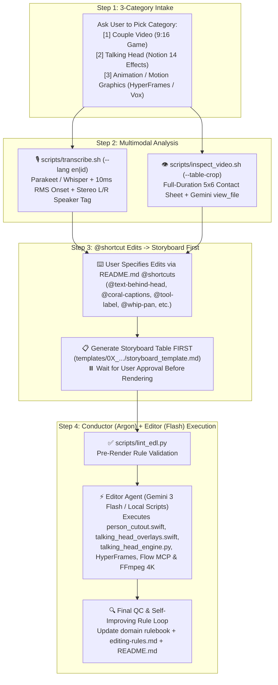

# AI Video Editor — Gemini 4 Argon (Conductor) + Gemini 3 Flash (Editor) Master System

> **Master Reference & `@shortcut` Dictionary**: Always read [`README.md`](./README.md) for the complete `@shortcut` Keyword Dictionary and 3-Category Template structure.

---

## 1. Conductor + Editor Multi-Agent Architecture



---

## 2. Mandatory Always-On Rules for the AI Conductor & Editor

### Rule A: Every New Project Conversation Starts With the 3-Category Choice & Storyboard First
1. **Step 1 — Offer the 3 Video Categories**:
   Whenever starting a new video project or conversation in this workspace, ask the user which of the **3 Categories** we are building (if not already specified):
   - **`[1] Couple Video`** (`9:16 Vertical Game / Challenge` — loads [`.agents/skills/youtube-edit/references/editing-rules-couple.md`](./.agents/skills/youtube-edit/references/editing-rules-couple.md) & [`templates/01_couple_video/`](./templates/01_couple_video/))
   - **`[2] Talking Head`** (`Solo Creator + FeedMedia Notion 14-Effect System` — loads [`.agents/skills/youtube-edit/references/editing-rules-talking-head.md`](./.agents/skills/youtube-edit/references/editing-rules-talking-head.md) & [`templates/02_talking_head/`](./templates/02_talking_head/))
   - **`[3] Animation / Motion Graphics`** (`HyperFrames 4K & Vox Editorial Collage` — loads [`.agents/skills/youtube-edit/references/editing-rules-animation.md`](./.agents/skills/youtube-edit/references/editing-rules-animation.md) & [`templates/03_animation_motion_graphics/`](./templates/03_animation_motion_graphics/))
2. **Step 2 — Analyze & Understand the Raw Video First**:
   - Run `./scripts/transcribe.sh "raw/<Project>/<clip>.MOV" --lang en|id` (which automatically runs [`scripts/acoustic_onset.py`](./scripts/acoustic_onset.py) for 10ms RMS onset snapping and Left/Right speaker tagging).
   - Run `./scripts/inspect_video.sh "raw/<Project>/<clip>.MOV"` (adding `--table-crop` for card/prop games) and call `view_file` on the contact sheet and raw video (`< 100 MB`).
   - Present a crisp summary of the raw footage takes and timestamps so the user can tell you what edits they want using the `@shortcut` keywords in [`README.md`](./README.md).
3. **Step 3 — ALWAYS Present the Storyboard Table Before Rendering**:
   - Translate the user's requested `@shortcut` edits into the category's **Beat-by-Beat Storyboard Table** (`templates/0X_.../storyboard_template.md`) so the user can visualize every beat, spoken line, and effect before rendering.
4. **Step 4 — Conductor (`Gemini 4 Argon`) + Editor (`Gemini 3 Flash`) Division of Labor**:
   - **Gemini 4 Argon (The Conductor / Creative Director)** designs the Storyboard and EDL JSON, runs `python3 ./scripts/lint_edl.py`, and verifies the final render.
   - **Gemini 3 Flash (The Editor)** can be invoked via `invoke_subagent(Model="flash")` (or run directly) to execute the deterministic Swift/Python/HyperFrames/FFmpeg scripts following the exact `@shortcut` specifications in [`README.md`](./README.md).

### Rule B: Image & Video Generation via Google Flow MCP (`GTAI-1/flow-mcp` / `miyakejima/google-flow-mcp`)
Whenever bespoke B-roll images (**Nano Banana / Imagen 4K**) or AI video clips (**Veo 3.1**) are needed (`@flow-image` / `@flow-video`), use the configured **Google Flow MCP** (`tools/flow-mcp` or `tools/google-flow-mcp`) to generate assets at $0 API cost into `broll/flow/`, applying the mandatory unification pass when used in Vox-style explainers.

### Rule C: Post-Edit Revision $\rightarrow$ Permanent Rule & `@shortcut` Update Protocol (NEVER SKIP)
Every time after a video edit, when the user gives a revision or piece of feedback:
1. **Execute the Revision Immediately** and re-render the video.
2. **Save the Lesson Forever**:
   - Update the matching domain rulebook ([`editing-rules-couple.md`](./.agents/skills/youtube-edit/references/editing-rules-couple.md), [`editing-rules-talking-head.md`](./.agents/skills/youtube-edit/references/editing-rules-talking-head.md), or [`editing-rules-animation.md`](./.agents/skills/youtube-edit/references/editing-rules-animation.md)).
   - Log the revision in the **Master Feedback Changelog** at the bottom of [`.agents/skills/youtube-edit/references/editing-rules.md`](./.agents/skills/youtube-edit/references/editing-rules.md).
   - If a new reusable effect or keyword was introduced, add its `@shortcut` to [`README.md`](./README.md).

### Rule D: Environment PATH & Per-Project Folder Organization
- Always ensure Homebrew and local binaries are on `PATH`:
  ```bash
  export PATH="/opt/homebrew/bin:/usr/local/bin:$HOME/.local/bin:$PATH"
  ```
- Always mirror `raw/<Project Name>/` across `renders/final/<Project Name>/`, `renders/drafts/<Project Name>/`, `transcripts/<Project Name>/`, and `broll/<Project Name>/`.
