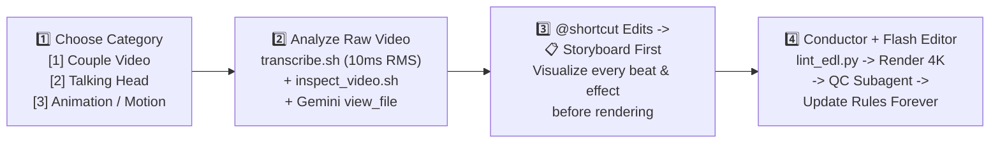

# AI Video Editor — Conductor (`Gemini 4 Argon`) + Editor (`Gemini 3 Flash`) Master System

> **100% Free Local & Open-Source Stack on Apple Silicon M4**
> Built so **Gemini 4 Argon** acts as the **Conductor & Creative Director** (watching raw footage natively, designing storyboards, enforcing rules, and running QC) while **Gemini 3 Flash** (or any AI agent) can act as the **Fast Hands-On Video Editor** using deterministic `@shortcut` keywords, JSON templates, and modular rulebooks.

---

## 🚀 Mandatory 4-Step Workflow (Every Conversation Starts Here)



### Step 1: Pick Your Video Category (3 Options)
At the beginning of every new project or conversation, choose one of the **3 Categories**:
1. **`[1] Couple Video`** (`9:16 Vertical Couple Game / Challenge` — `Angel` & `Arthur`)
   - **Rulebook**: [`.agents/skills/youtube-edit/references/editing-rules-couple.md`](./.agents/skills/youtube-edit/references/editing-rules-couple.md) (`Rules C1–C15`)
   - **Templates**: [`templates/01_couple_video/storyboard_template.md`](./templates/01_couple_video/storyboard_template.md) · [`templates/01_couple_video/edl_template.json`](./templates/01_couple_video/edl_template.json)
2. **`[2] Talking Head`** (`Solo Creator / Tutorial / Explainer` — **FeedMedia Notion 14-Effect System**)
   - **Rulebook**: [`.agents/skills/youtube-edit/references/editing-rules-talking-head.md`](./.agents/skills/youtube-edit/references/editing-rules-talking-head.md) (`Rules TH1–TH25`)
   - **Templates**: [`templates/02_talking_head/storyboard_template.md`](./templates/02_talking_head/storyboard_template.md) · [`templates/02_talking_head/edl_template.json`](./templates/02_talking_head/edl_template.json)
   - **Engines**: [`scripts/talking_head_engine.py`](./scripts/talking_head_engine.py) · [`scripts/talking_head_overlays.swift`](./scripts/talking_head_overlays.swift) · [`scripts/person_cutout.swift`](./scripts/person_cutout.swift)
3. **`[3] Animation / Motion Graphics`** (`HyperFrames 4K HTML/CSS/GSAP & Vox Editorial Paper Collage`)
   - **Rulebook**: [`.agents/skills/youtube-edit/references/editing-rules-animation.md`](./.agents/skills/youtube-edit/references/editing-rules-animation.md) (`Rules AM1–AM11`)
   - **Templates**: [`templates/03_animation_motion_graphics/storyboard_template.md`](./templates/03_animation_motion_graphics/storyboard_template.md) · [`templates/03_animation_motion_graphics/edl_template.json`](./templates/03_animation_motion_graphics/edl_template.json)

### Step 2: Analyze & Understand the Raw Video
Once a category and raw file (`raw/<Project Name>/<clip>.MOV`) are selected, the AI runs:
```bash
# English / Tech Talking Head (Parakeet-MLX + 10ms RMS Acoustic Onset):
./scripts/transcribe.sh "raw/<Project Name>/<clip>.MOV" --lang en

# Indonesian / Bilingual Couple Game (Whisper + 10ms RMS Onset + Stereo L/R Speaker Tagging):
./scripts/transcribe.sh "raw/<Project Name>/<clip>.MOV" --lang id

# Full-Duration 5x6 Contact Sheet (add --table-crop for card/prop games):
./scripts/inspect_video.sh "raw/<Project Name>/<clip>.MOV" --table-crop
```
Then the Conductor calls `view_file` on the contact sheet and raw video to understand every take, facial reaction, and timestamp.

### Step 3: Describe Desired Edits with `@shortcut` Keywords $\rightarrow$ **Always Storyboard First**
Tell the AI which edits you want using the **`@shortcut` Keyword Dictionary** below (e.g., *"Use `@text-behind-head` on the intro, `@coral-captions` throughout, pop `@tool-label` when I say FFmpeg, and use `@whip-pan` before the demo"*).
- **Mandatory Storyboard Gate**: Before rendering any video, the AI **ALWAYS** generates the **Beat-by-Beat Storyboard Table** (`Timecode | Spoken Words | @shortcut | What's On Screen | Engine`) so you can visualize and approve the edit first!

### Step 4: Conductor (`Gemini 4 Argon`) + Editor (`Gemini 3 Flash`) Execution & Self-Improving Loop
- **Conductor (`Gemini 4 Argon`)**: Writes the approved EDL JSON, runs `python3 ./scripts/lint_edl.py --edl <edl.json> --category <couple|talking_head|animation>`, and orchestrates the build.
- **Editor (`Gemini 3 Flash` Subagent / Engine)**: Can be spawned via `invoke_subagent(Model="flash")` to execute the Swift overlay generators, Apple Vision person cutouts, HyperFrames renders, and FFmpeg master assembly.
- **Self-Improving Memory**: Every revision you request updates the video **AND** permanently appends/updates the rule in the domain rulebook + [`editing-rules.md`](./.agents/skills/youtube-edit/references/editing-rules.md) (and adds new `@shortcut` keywords to this `README.md` whenever you invent a new effect!).

---

## ⌨️ Master `@shortcut` Keyword Dictionary (Organized by Category)

Use any of these `@shortcut` keywords when describing your edits after raw video analysis. Both **Gemini 4 Argon (Conductor)** and **Gemini 3 Flash (Editor)** are programmed to translate each keyword into its exact technical recipe.

---

### Category 1: Couple Video Shortcuts (`9:16 Vertical Game / Challenge` — `editing-rules-couple.md`)

| `@shortcut` Keyword | What It Does (Visual & Audio Spec) | Exact Parameters & Rule Reference |
| :--- | :--- | :--- |
| **`@hook-bean-boozle`** | Displays the 2-line opening title (`challenge` + `GAME NAME 🔥`) immediately from `0:00:00` on the first spoken syllable, with zero bottom caption and no blue/dark gradient. Also saves `*_cover.png`. | Line 1: `HelveticaNeue-Bold` (`136pt` @ 4K, `#000000` fill, `#FFFFFF` stroke). Line 2: `Arial-Black` (`192pt` @ 4K, `#FFFFFF` fill, `-8.0` dark edge, soft shadow). (`Rules C2, C7`) |
| **`@wide`** | Locks steady `1.00x` wide side-by-side framing so both **Angel** (Left) and **Arthur** (Right) stay visible without jarring jump-cut zoom alternation. | `scale=2160:3840` (`Rule C3`) |
| **`@one-word-captions`** | Pops strictly **one spoken word at a time** at the bottom of the frame synced to the 10ms RMS acoustic onset, disappearing immediately during pauses. | `PlayRes 2160x3840`, `Arial Black 108pt`, `MarginV: 330`, zero emojis in `.ass` (`Rule C9`) |
| **`@head-pop-angel`** / **`@head-pop-arthur`** | Pops an Extra-Bold capital letter or short word guess (`G`, `S`, `MANIS! 🍬`) above Angel (`x=610, y=1020` @ 4K) or Arthur (`x=1520, y=1020` @ 4K) on the exact spoken syllable + `pop.wav`. | Hidden during countdowns; auto-disappears after `1.4s–1.8s` max (`Rule C10`) |
| **`@top-word`** | Displays a borderless completed-word callout (`API! 🔥`, `MANDI UANG 💸`) at the top (`y=470` @ 4K) strictly **after** the word is solved and vocalized. | Auto-disappears after `3.0s–4.0s`; clears bottom word tracker (`Rules C8, C11`) |
| **`@header-cari`** $\rightarrow$ **`@header-dapat`** | Turn-based card search headers: shows `[PLAYER]: CARI [ITEM] 🚜` while hunting on the table, and switches to `[PLAYER]: DAPAT [ITEM]! 🚜` (`+ correct_ding.wav`) **only** when the matching card is physically flipped face up. | Separated `Arial-Black` + `AppleColorEmoji` runs; verifies color variants like `TRAKTOR BIRU` vs `TRAKTOR MERAH` (`Rules C8, C11`) |
| **`@timelapse-4x`** | Fast-forwards a 30-second card memorization phase at **`4.0x` speed** (`setpts=PTS/4.0, atempo=2.0,atempo=2.0`) with rhythmic `clock_ticking.wav` and **no bottom caption**. | Compresses 30s memorization into 7.5s while keeping gameplay 100% uncut (`Rule C5`) |
| **`@uncut-speed`** | Keeps 100% of card placing/searching/flipping uncut so the audience plays along mentally, dynamically modulating speed (`1.25x–1.70x`) to finish under `< 2:30` (`150s`). | `1.30x` reveals, `1.45x` card flips, `1.65x` table scans (`Rules C4, C5`) |
| **`@bw-zoom-arthur`** / **`@bw-zoom-angel`** | Fast animated punch-in zoom (`1.15x -> 2.15x` over `0.17s`) onto the speaker's stunned face + instant **Black & White** desaturation + Chopin Nocturne swell (`0.48`). | Used on blunders, wild admissions (`"SANTET?!"`), or losses (`Rule C13`) |
| **`@meme-what`** / **`@meme-okay`** | Cuts after a loss/blunder to a comfortably framed 9:16 portrait reaction meme (`What_ Meme.mp4` or `Hi! Okay,,,.mp4` from `4.00s–6.64s`) with **`+14 dB` speech boost** and `0.03` music dip. | Restricted **strictly to losses/blunders** (never mid-game or on a tie `SERI`) (`Rule C13`) |
| **`@header-tally`** $\rightarrow$ **`@winner-parade`** | Holds header on `HITUNG POIN! 🃏` while counting cards, then fires `[WINNER]: [X] POIN — DOUBLE GUYS! ✌️🎉` + 4K 3D paper confetti (`confetti_loop.mov`, zero emojis over faces) + `party_cheer.wav` (`1.1x`). | Triggered strictly after the final card is counted (`Rule C12`) |
| **`@chopin-eb`** | Locks background music to authentic **Chopin Nocturne in E-flat major, Op. 9, No. 2** (`audio/music/nocturne_op9_in_eb.wav`). | `0.10` (`-20dB`) dialogue, `0.48` B&W zoom, `0.03` meme (`Rule C14`) |

---

### Category 2: Talking Head Shortcuts (`FeedMedia Notion 14-Effect System + Antigravity M4` — `editing-rules-talking-head.md`)

| `@shortcut` Keyword | What It Does (FeedMedia Notion Spec Adapted for Antigravity M4) | Engine & Exact Parameters (`Rule Reference`) |
| :--- | :--- | :--- |
| **`@storyboard-first`** | *(Notion #1)* Writes a complete beat-by-beat table (`Time | Exact Words | What's On Screen | @shortcut | Tool`) and waits for approval before rendering. | [`templates/02_talking_head/storyboard_template.md`](./templates/02_talking_head/storyboard_template.md) (`Rule TH1`) |
| **`@person-cutout`** | *(Notion Setup)* Hardware-accelerated Apple Vision (`VNGeneratePersonSegmentationRequest`) person cutout exporting a feathered 4K `ProRes 4444` alpha matte (`.mov`). | `swift ./scripts/person_cutout.swift --input ... --start ... --end ... --output ...` (`Rule TH9`) |
| **`@text-behind-head`** | *(Notion #2)* Places a 2-line title (`Geist Pixel Square` / `Arial-Black`, `150px` / `300px` @ 4K, `#F4F4F2`) **between** the raw footage and your person cutout at **`20%` and `27%`** height. Fades up over 12 frames (`cubic.out`, rising `2%`), Line 2 delayed by 4 frames. | `person_cutout.swift` + `talking_head_overlays.swift` + FFmpeg 3-layer overlay (`Rule TH10`) |
| **`@coral-captions`** | *(Notion #3)* `Helvetica Neue Bold`, `64px` (`128px` @ 4K), white with soft shadow at **`61.5%`** height. Up to **3 words at a time**; **ONLY the active spoken word** sits on a rounded coral (`#D97757`, `8px`/`16px` radius) box. | `talking_head_overlays.swift` (`type: "coral_pill_3word"`) + 10ms RMS onset (`Rule TH11`) |
| **`@tool-label`** | *(Notion #4)* When naming a tool, its logo (`110px`/`220px`, rounded corners) fades up at **`61.5%`** height over 12 frames (`cubic.out`), then slides left while the bold white name (`92px`/`184px`) slides out right over 12 frames so both end centered + `pop.wav`. | `talking_head_overlays.swift` / HyperFrames (auto-hides `61.5%` captions during label) (`Rule TH12`) |
| **`@repo-card`** | *(Notion #5)* When mentioning an open-source repo, fades up a **GitHub Dark Theme card** (`#0D1117` bg, `#30363D` border, **`85%` frame width**) over 12 frames (`cubic.out`, rising `2%`) showing `owner/name`, `Public` badge, description, stars, and forks. | `talking_head_overlays.swift` (`type: "repo_card"`) + auto-locks camera to `1.00x` (`Rule TH13`) |
| **`@prompt-bar`** | *(Notion #6)* Reusable vector prompt bar at **`22.5%` height, `92.6%` width**: dark rounded pill (`#2B2B2B`), white `Inter` text typing in, and a coral (`#D97757`) send button with up-arrow + `click.wav`. | `talking_head_overlays.swift` (`type: "prompt_bar"`) / HyperFrames (`Rule TH14`) |
| **`@color-slider`** | *(Notion #7)* Makes a warm version (`colorchannelmixer=rr=1.17:gg=1.10:bb=1.03,eq=saturation=1.12`), starts on warm, and wipes right-to-left over **30 frames** (`ease-in-out cubic`) with a thin white vertical line + `whoosh.wav`. | Single-pass FFmpeg `filter_complex` in `talking_head_engine.py` (`Rule TH15`) |
| **`@magazine-cover`** | *(Notion #8)* Turns shot into a magazine cover with person cutout: cream serif masthead (`"CLAUDE"`) **behind** head, thin gold frame (`#D4AF37`), top-corner cover lines, and left barcode **in front**, popping each element in on a **stressed word**. | `person_cutout.swift` + `talking_head_overlays.swift` + acoustic stress peaks (`Rule TH16`) |
| **`@real-screenshot`** | *(Notion #9)* Fades up an authentic high-DPI screenshot of your editor timeline / paper / UI above your head: **`90%` frame width**, rounded corners, soft shadow, 12 frames (`cubic.out`). | `capture_broll.mjs` + `talking_head_overlays.swift` (`Rule TH17`) |
| **`@whip-pan`** | *(Notion #10B — Recommended Transition)* Last **6 frames** of Shot A slide left `8%` + horizontal blur up to `50px` (`ease-in`). Cut + `whoosh.wav`. Shot B starts `8%` right, `50px` blurred, settling into place over **6 frames** (`cubic.out`). | FFmpeg `boxblur`/`dblur` transition in `talking_head_engine.py` (`Rule TH18`) |
| **`@pip-zoom-3x`** | *(Notion #10A)* On a trigger word (`"this"`), shrinks shot into a picture of itself **3 levels deep** above head, holds, then pushes through into the next shot. | HyperFrames / FFmpeg 3-branch nested overlay (`Rule TH18`) |
| **`@moody-grade`** | *(Notion #11)* Grades clip with FFmpeg (`curves` pulling highlights down & lifting blacks, `-15%` saturation, soft `vignette`) while showing a floating **Lightroom UI panel** (`Tone Curve`, `Basic`, `Effects`) above head that moves each slider as spoken. | FFmpeg live grade blend + HyperFrames Lightroom panel (`Rule TH19`) |
| **`@wall-of-reels`** | *(Notion #12)* Downloads 8 vertical reels via `yt-dlp`, shrinks your shot into the **center tile of a `3×3` grid**, and pops the other 8 reels into the surrounding tiles **1 per frame**. | `yt-dlp` + FFmpeg `3×3` grid compositor (`Rule TH20`) |
| **`@pause-explain`** | *(Notion #13)* Plays a clip in a top-left window (**`54%` width**) with live corner timecode. On `click.wav`, freezes video & timecode; **10 frames later**, shrinks window to left side (**`24%` width**, rounded corners) over **12 frames** (`cubic.out`) while explaining, then grows back and plays. | FFmpeg `tpad` freeze + animated PIP scale (`Rule TH21`) |
| **`@jump-cuts`** | *(Notion #14)* Cuts every pause `> 0.22s` (never inside a word, `0.04s`/`0.06s` micro-padding + `15ms` audio crossfade) and alternates normal (`1.00x`) and tight (`1.15x` at `y=42%` eye-line) framing on every cut. | `talking_head_engine.py` (`Rules TH4, TH5`) |

---

### Category 3: Animation & Motion Graphics Shortcuts (`HyperFrames 4K & Vox Collage` — `editing-rules-animation.md`)

| `@shortcut` Keyword | What It Does (Visual & Motion Spec) | Engine & Rule Reference |
| :--- | :--- | :--- |
| **`@vox-collage`** | Full tactile editorial paper-collage world: warm cream paper (`#F4EDDE`), dark ink borders (`#191713`), halftone dot textures, and stepped stop-motion easing (`steps(3)`). | HyperFrames `0.8.180` (`window.__timelines["main"]`) (`Rules AM2, AM7`) |
| **`@vox-cutout`** | Searches real archival/editorial human photography ($\ge 1000\text{px}$ via Wikimedia/Openverse) and runs the mandatory **Unification Pass** (`duotone contrast=1.2 saturation=0.7` + halftone + torn white paper edge + drop shadow). Zero geometric block/pill placeholders! | `scripts/fetch_real_assets.py` + `scripts/prepare_runner_cutouts.py` (`Rules AM7, AM8, AM10`) |
| **`@empty-canvas`** | Starts every beat at `0.00s` on a clean background plate (zero pre-baked moving subjects) and animates every character/prop entering dynamically via staggered stamps or card deals. | `scripts/generate_clean_plates.py` (`Rule AM9`) |
| **`@paper-banner-captions`** | Renders subtitles on organic cream paper strips (`#F4EDDE`) with dark ink borders (`#191713`) and sweeps a warm Vox yellow marker highlight (`#FFD51F`, `mix-blend-mode: multiply`) across active spoken words. | HyperFrames DOM caption controller (`Rule AM7`) |
| **`@unequal-lines`** | Animates 5 distinct brightly colored horizontal starting lines (**Yellow, Red, Coral, Teal/Cyan, Navy**) sweeping across staggered lanes to visually prove *"nobody started at the same line"*. | HyperFrames GSAP SVG/div sweep (`Rule AM11`) |
| **`@british-neural-vo`** | Generates natural human British English documentary voiceover (`en-GB-RyanNeural`) with **strictly zero hyphens** in numbers (`"twenty two"`, `"twenty nine"`). | `scripts/build_neural_vo.py` (`Rule AM7`) |
| **`@tech-dark-4k`** | Sleek 4K dark-mode kinetic data/architecture animation (`#0A0D14` bg, `#38BDF8` sky accent, `#FACC15` gold highlight, `#4ADE80` emerald, `Inter` + `JetBrains Mono` inside 10% safe margins). | `npx hyperframes lint` + `npx hyperframes render` (`Rules AM1–AM6`) |

---

### Universal Audio, AI Generation & Export Shortcuts (`editing-rules.md` — `Rules U1–U8`)

| `@shortcut` Keyword | What It Does | Tool / Script |
| :--- | :--- | :--- |
| **`@flow-image`** / **`@flow-video`** | Generates bespoke 4K B-roll images (**Nano Banana / Imagen**) or video clips (**Veo 3.1**) at $0 API cost via **Google Flow MCP** (`GTAI-1/flow-mcp` or `miyakejima/google-flow-mcp`). | `flow_status` $\rightarrow$ `flow_generate` $\rightarrow$ `flow_wait` |
| **`@free-bgm`** | Searches and downloads 100% royalty-free / CC0 background music from Openverse (Jamendo/Freesound/Wikimedia) or YouTube Audio Library via `yt-dlp`. | `free-audio` MCP (`scripts/free_audio_mcp.mjs`) |
| **`@master-4k`** | Renders final studio master in **Native 4K (`2160×3840` or `3840×2160`)**, H.264 High@L5.2, `-preset slow -crf 14`, `45–50 Mbps`, explicit `bt709` Rec.709 color tags, isolated `-14 LUFS` voice normalization, and `normalize=0` mixing. | `Rule U4, U6` |
| **`@qc-check`** | Runs `scripts/lint_edl.py`, generates a post-render contact sheet via `scripts/inspect_video.sh`, inspects via `view_file`, and invokes the `caption-qc-reviewer` subagent to verify 100% word accuracy. | `Rule U2, U7` |

---

## 🎨 Google Flow MCP Setup (Free Image & Video Generation via Nano Banana / Imagen & Veo)

Our subagent evaluated both [`GTAI-1/flow-mcp`](https://github.com/GTAI-1/flow-mcp) and [`miyakejima/google-flow-mcp`](https://github.com/miyakejima/google-flow-mcp). Both connect to **Google Flow** (`labs.google/fx/tools/flow`) using your existing Google account session ($0 API cost).

- **Primary Recommendation (`GTAI-1/flow-mcp`)**: Uses direct Chrome DevTools Protocol (`CDP port 9333`) with **zero Chrome extension needed**. Exposes `flow_status`, `flow_generate` (Nano Banana / Imagen images & Veo videos in `9:16` or `16:9`), and `flow_wait` (auto-downloads to `broll/flow/`).
- **Power-User Alternative (`miyakejima/google-flow-mcp`)**: Includes `npm run setup:antigravity`, multi-account credit rotation (`flow_list_accounts`), Nano Banana 2 inpainting/outpainting, and Veo 3.1 clip extension via a companion Chrome extension.

### Quick Install (`GTAI-1/flow-mcp`)
```bash
export PATH="/opt/homebrew/bin:/usr/local/bin:$HOME/.local/bin:$PATH"
mkdir -p tools && cd tools
git clone https://github.com/GTAI-1/flow-mcp.git
cd flow-mcp && npm install && npm run build
```
Then add `"flow"` to `/Users/arthurandersen/.gemini/antigravity/mcp_config.json`:
```json
{
  "mcpServers": {
    "flow": {
      "command": "/opt/homebrew/bin/node",
      "args": ["/Users/arthurandersen/Documents/AI_Video_Editor_Gemini/tools/flow-mcp/dist/index.js"],
      "env": {
        "FLOW_MCP_OUTPUT": "/Users/arthurandersen/Documents/AI_Video_Editor_Gemini/broll/flow",
        "FLOW_MCP_HOME": "/Users/arthurandersen/.flow-mcp",
        "FLOW_MCP_CDP_PORT": "9333",
        "FLOW_MCP_PORT": "8787"
      }
    }
  }
}
```

---

## 📁 Repository Structure (3-Category Organization)

```text
AI_Video_Editor_Gemini/
├── README.md                                  # Master Workflow & @shortcut Keyword Dictionary
├── GEMINI.md                                  # Always-On Conductor & Editor Rules for Antigravity
├── .agents/skills/
│   ├── youtube-edit/
│   │   ├── SKILL.md                           # 4-Step Storyboard-First Execution Runbook
│   │   └── references/
│   │       ├── editing-rules.md               # Master Router, Universal Rules (U1-U8) & Changelog
│   │       ├── editing-rules-couple.md        # Category 1: Couple Video Rules (C1-C15)
│   │       ├── editing-rules-talking-head.md  # Category 2: Talking Head & Notion Effect Rules (TH1-TH25)
│   │       └── editing-rules-animation.md     # Category 3: HyperFrames 4K & Vox Collage Rules (AM1-AM11)
│   └── hyperframes/
│       └── SKILL.md                           # HyperFrames 0.8.180 Deterministic GSAP Guide
├── templates/
│   ├── 01_couple_video/                       # Category 1: Couple Game EDL & Storyboard Templates
│   │   ├── edl_template.json
│   │   └── storyboard_template.md
│   ├── 02_talking_head/                       # Category 2: Talking Head EDL & Storyboard Templates
│   │   ├── edl_template.json
│   │   └── storyboard_template.md
│   └── 03_animation_motion_graphics/          # Category 3: HyperFrames / Vox EDL & Storyboard Templates
│       ├── edl_template.json
│       └── storyboard_template.md
├── scripts/
│   ├── transcribe.sh                          # Parakeet (EN) / Whisper (ID) + 10ms RMS Acoustic Onset
│   ├── acoustic_onset.py                      # 10ms RMS Onset Snapper + Stereo L/R Speaker Diarization
│   ├── inspect_video.sh                       # Full-Duration 5x6 Contact Sheet + --table-crop
│   ├── lint_edl.py                            # Pre-Render Rule Linter across all 3 Categories
│   ├── person_cutout.swift                    # Apple Vision ANE Person Cutout -> ProRes 4444 (.mov)
│   ├── talking_head_overlays.swift            # Native 4K CoreText/AppKit Notion Effect Overlays
│   ├── talking_head_engine.py                 # Declarative Talking Head Master Builder
│   ├── capture_broll.mjs                      # Headless Chrome 4K Retina Screenshot Capture
│   ├── free_audio_mcp.mjs                     # 100% Free Audio MCP (Openverse + yt-dlp + Studio SFX)
│   └── build_*.py                             # Per-Project Couple & Vox Master Builders
├── audio/
│   ├── music/nocturne_op9_in_eb.wav           # Authentic Chopin Nocturne in E-flat major, Op. 9, No. 2
│   └── sfx/                                   # 48kHz-Normalized Studio & Game-Show SFX Pack
├── raw/                                       # Source Camera Recordings (by Project Folder)
├── transcripts/                               # Word-Level + 10ms RMS Acoustic Onset JSONs
├── broll/                                     # Rendered Swift/HyperFrames Overlays, Cutouts & Memes
└── renders/
    ├── drafts/<Project Name>/                 # Contact Sheets & Fast Preview Cuts
    └── final/<Project Name>/                  # Native 4K Studio Master MP4s & Cover PNGs
```
