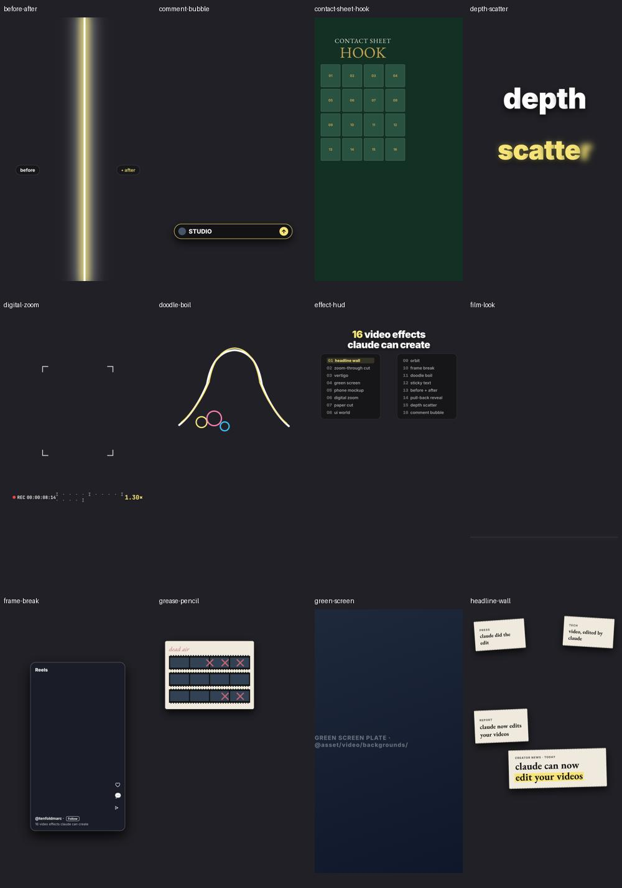
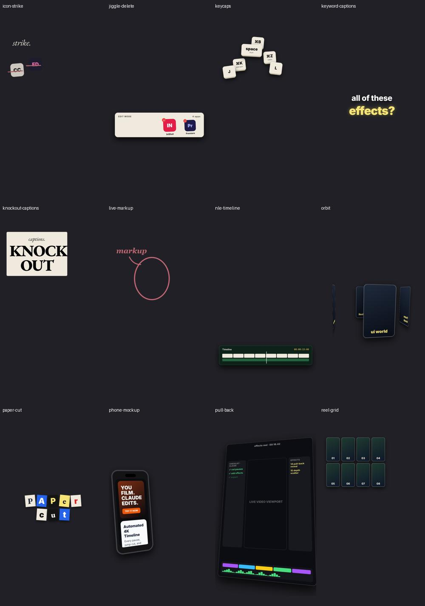
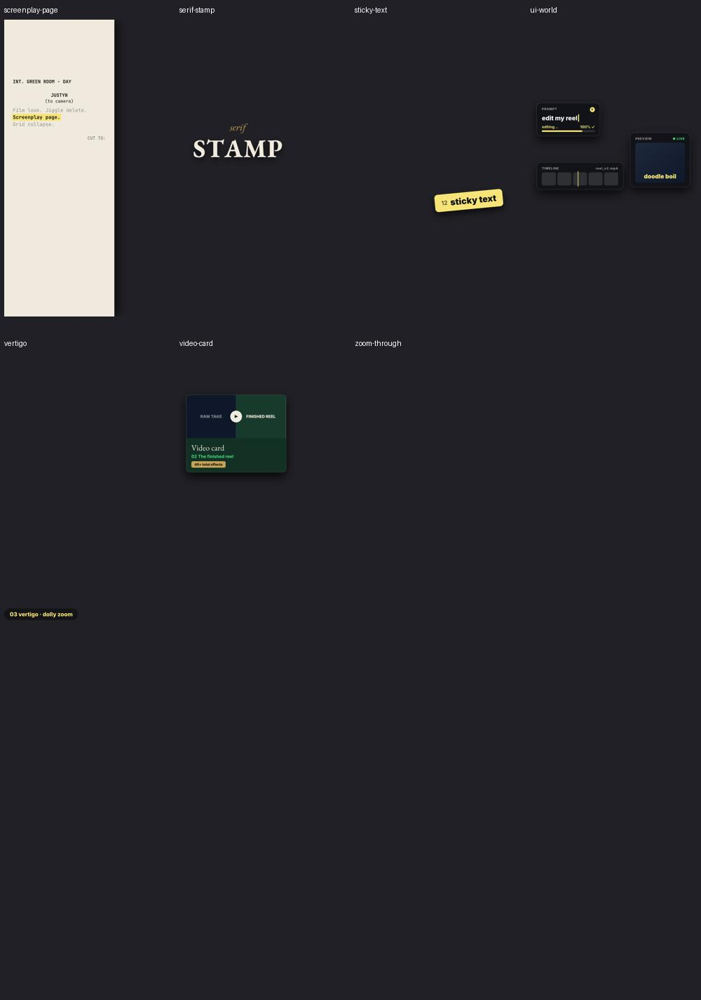

# AI Video Editor: System and Editorial Audit

Date: 2026-10-29. Scope: current working tree, with vertical talking-head reels as the target product. An independent subagent cross-checked architecture, validation, timing, feedback, and runtime behavior. This report changes no implementation. Recommendations below are proposed work, not implemented capabilities.

## 1. Assessment

This repository is an agent-guided production toolkit with substantial editorial experience, particularly from couple-game revisions. It is not yet a reliable, declarative end-to-end talking-head editor. The largest problem is the gap between documented promises and executable behavior. A model can follow the instructions and produce a valid-looking EDL whose effects never appear.

Preserve the useful foundations: storyboard approval, category-specific creative direction, reusable assets, local transcription, explicit timing, Swift typography, HyperFrames scenes, FFmpeg assembly, and the existing feedback table. Connect and validate those foundations before expanding the effect catalogue.

“Any model” is achievable through a stable command and file contract. It does not require every model to watch video natively or understand FFmpeg internals. macOS-specific rendering providers can remain underneath that contract.

## 2. How the current system works

### Intended flow

Footage → transcript and visual inspection → keeper script and storyboard → approval → EDL → asset generation and effects → FFmpeg render → QC → user revision → rulebook/linter update.

### Executable reality

| Stage | Existing implementation | Missing connection or limitation |
| --- | --- | --- |
| Intake | Footage organized manually under `raw/<Project>/` | No project manifest, media identity, or resumable project command |
| Transcription | `transcribe.sh`: FFmpeg extraction, Parakeet/Whisper selection, acoustic refinement | Dependencies and output schemas are not versioned; review remains necessary |
| Inspection | `inspect_video.sh`: console diagnostics, contact sheets, proxy | Basename collisions, no structured QC result, no enforced proxy size budget |
| Editorial decisions | Agent reads footage, transcript, rules, storyboard templates | No keeper-decision artifact or automated semantic retake selection |
| Cuts | `talking_head_engine.py` slices supplied segments, adjusts speed/zoom, concatenates | Pause thresholds do not generate cuts; agent must already supply segments |
| Effects | Five distinct static Swift overlay types, limited segment grading | No HyperFrames adapter, cutout compositing, general video effects, or SFX timeline |
| Captions | Explicit coral-caption effects can produce PNGs | No automatic transcript-to-caption schedule; `caption_style` alone does nothing |
| Audio/export | Voice loudnorm, fixed music gain, limiter, H.264/AAC | No automatic ducking, SFX mix, enforced FPS, or measured final acceptance gate |
| QC | Human/agent instructions and inspection helpers | No implemented `caption-qc-reviewer` definition found; no required QC artifact |
| Revisions | Markdown feedback table and domain rules | No automatic run lineage, immutable EDL versions, action log, or retrieval command |

The couple builders contain project-specific editorial decisions inside large Python scripts. Animation/Vox utilities likewise include fixed project paths and timing. These are valuable production examples, but do not form a general project-independent engine.

## 3. Verified engineering findings

### P0: basic rendering and capability correctness

1. **No-overlay talking-head renders fail.** `talking_head_engine.py:289` initializes `v_cur` to `[0:v]`, then passes it to `-map` at line 321. Without an overlay, FFmpeg treats this as a nonexistent filter output label. Reproduced with a synthetic source. Fix input-stream mapping separately from filter-label mapping.
2. **The shipped whip-pan fails.** Line 135 uses `t` inside the `boxblur` radius expression. Installed FFmpeg rejects it. The talking-head template requests this transition. Replace it with a supported time-enabled filter/transition implementation and test both outgoing and incoming shots.
3. **Most effects are silently ignored.** Lines 245–275 recognize only aliases for coral captions, text title, tool label, repo card, and prompt bar. There is no HyperFrames invocation. Unknown requests must fail before rendering, with supported alternatives listed.
4. **Asset handles are not connected.** `resolve_handle()` at lines 45–60 is never called. Source, logos, and music are read directly. Handle-based source fails; logos can fall back to a colored square; handle-based music can disappear. Resolve every referenced asset in one preflight pass, verify existence/type, and record the resolved manifest.
5. **Behind-head effects lack the foreground layer.** The engine ignores `cutout_mov` and composites title PNGs over the source. Implement background → behind-text → aligned subject → front-graphics layers.

### P1: timing, validation, and quality

- **Removed-source times map to the end.** `map_raw_to_timeline()` at lines 63–73 returns accumulated duration when a time is outside retained segments. Source time 15 with retained intervals `[10,12]`, `[20,22]` maps to 4 seconds. Use interval intersection and explicit absent mappings; split effects crossing edits and account for speed.
- **FPS is ignored.** A successful repo-card smoke render with source 30 fps and EDL 60 fps remained 30 fps. Read the delivery profile, normalize intermediate timebases, and verify final frame count/FPS.
- **Validation accepts invalid playback and unsupported effects.** Pure-function checks accepted speed 0, speed -1, unknown effects, missing approval, and four words in an actual coral-caption effect. The engine does not invoke the validator itself. Add a versioned structural schema plus semantic checks at the render entry point.
- **Caption validation and rendering read different fields.** Linter reads `edl.captions`; renderer reads `edl.effects`. One canonical caption schedule should drive both validation and rendering.
- **Approval is a warning with a permissive default.** `lint_edl.py:127–128`. Approval should reference the reviewed plan hash, so later timeline changes cannot inherit stale approval. Respect explicit user authorization for unattended operation.
- **Collision policies differ.** The engine guards prompt bars; the linter's top-zone list omits them. A shared registry must supply occupancy, depth, dependencies, and supported aliases. Also validate collisions between overlays, not only overlay-versus-zoom.
- **Jump-cut settings overstate automation.** `max_pause_sec`, pre/post padding, and eyeline options are not used to create cuts. Create reviewed keeper ranges first, then compile cuts while preserving consonants, breaths, emphasis, and meaningful pauses.
- **Audio behavior is partial.** Voice uses one-pass loudnorm; music uses fixed gain; effect SFX fields are ignored. Measure voice/final mix, support sidechain or scheduled ducking, and verify peaks after mixing. CRF plus a stated bitrate is not proof of delivered quality.
- **Portrait layout can distort.** Segment filters scale directly to W×H. Choose explicit crop/fit/reframe behavior, honor orientation, and let editorial review verify faces and screen content.

### P1: inspection, ASR, and segmentation

- `inspect_video.sh:16–17,37,68` stores proxies and sheets by clip basename in a shared directory. Two projects with `IMG_0001.MOV` collide. Use project/media IDs and a source hash.
- Its CRF proxy encode has no byte cap or size verification despite “Always <15MB.” Compute a duration-based bitrate budget and verify size, or split long clips.
- Ten-millisecond RMS windows are measurement granularity, not ten-millisecond word accuracy. `acoustic_onset.py:104–108` only adjusts some word starts; word ends retain ASR values. Keep uncertainty and review difficult words rather than claiming exact alignment.
- Angel/Arthur labels at `acoustic_onset.py:115–120` infer channel imbalance. They are not general speaker diarization; default talking-head mode should use configurable speakers or unknown labels.
- Missing acoustic inputs return success after warning (`:142–144`). Fail explicitly when a required output is absent or contains no usable words.
- `person_cutout.swift` computes transformed dimensions but does not apply the track transform to the decoded CIImage or specify matching Vision orientation. It ignores several reader/writer/segmentation errors and can retain the opaque original on segmentation failure. These are static risks requiring portrait-footage and alpha validation before certification.

## 4. Per-effect audit

These statuses describe implementation evidence, not a claim that every effect has been rendered over real footage. All 31 Pack 2/3 templates pass installed HyperFrames 0.8.214 lint. Static inspection found **zero reads of declared `vars` and zero image/video/audio elements in every one of those 31 scenes**. They currently animate fixed demonstration graphics. None is connected to the talking-head engine. Every template also declares 1080×1920, so native 4K graphics are not established by the current files.

For all effects: expose typed parameters that actually affect output; resolve real assets; define raw/output/local time explicitly; support entrance/hold/exit; apply configurable mobile safe areas; test transparency over light and dark footage; verify first/middle/last frames and parameter variants. Keep shared templates immutable and instantiate per project. Pin local GSAP/fonts instead of relying on CDN/font availability.

### Pack 1 and core talking-head operations

| Shortcut | Current state | Improvement |
| --- | --- | --- |
| `@storyboard-first` | Instruction/template | Store plan, alternatives, rationale summary, approval and hash |
| `@person-cutout` | Standalone Swift segmentation | Validate orientation, alpha, hair/hand edges, failure status and timing |
| `@text-behind-head` | Static title PNG over subject | Add aligned foreground matte, actual depth and staggered entry |
| `@coral-captions` | Static PNG per supplied active index | Compile every retained word to timed active-word events; handle wrapping and long words |
| `@one-word-captions` | Documented and used in couple builders; ignored by talking-head engine | Share a caption compiler with presets and language-aware grouping |
| `@tool-label` | Static label; unresolved logo handles | Load verified icon, animate icon/name, suppress conflicting caption window |
| `@repo-card` | Static PNG; runtime smoke passed | Fit long repository names/descriptions; animate entry; retain source metadata |
| `@prompt-bar` | Static PNG | Constrain text to available width, type deterministically, avoid title/card overlap |
| `@color-slider` | Segment-level warm grade only | Produce a real synchronized before/after wipe and divider |
| `@magazine-cover` | Documented, no rendering switch case | Separate masthead/subject/frame layers; validate face clearance |
| `@real-screenshot` | Capture tool exists; effect ignored | Load real capture with source URL/date, animate crop and readable detail |
| `@whip-pan` | Broken blur expression; no full two-shot transition | Frame-based outgoing/incoming transforms, directional blur, synchronized whoosh |
| `@pip-zoom-3x` | Documented, engine absent | Real nested source clips with controlled crop, legible scale and landing cut |
| `@moody-grade` | Segment grade exists; panel absent | Scene-appropriate grade, skin-tone review, optional animated UI |
| `@wall-of-reels` | Documented, engine absent | Real media grid, center-speaker framing, controlled decode load |
| `@pause-explain` | Documented, engine absent | Explicit freeze frame/audio policy, PIP motion and return timing |
| `@jump-cuts` | Applies supplied segments and zoom alternation | Derive candidates from words/pauses; let editor choose semantic keeps |

### Pack 2: all 19 scenes

| Effect | Actual scene | Required improvement |
| --- | --- | --- |
| `effect-hud` | Fixed checklist with one active row | Bind items/active index and both themes; avoid overwhelming the hook |
| `keyword-captions` | Fixed “all of these / effects?” animation | Bind words/themes/position; synchronize emphasis to speech |
| `headline-wall` | Fixed invented clipping text | Bind real/sourced headlines or clearly authored copy; improve paper edges and exits |
| `zoom-through` | Expanding ring and flash | Transform actual outgoing/incoming video; frame-lock flash duration |
| `vertigo` | Expanding dashed background graphic | Use real background and aligned subject; avoid duplicate subject ghosts |
| `green-screen` | Gradient plate with implementation label | Load replacement footage and subject matte; remove diagnostic copy from delivery |
| `phone-mockup` | CSS phone with sample content | Bind real screen media and frame; fit readable content and scroll intentionally |
| `digital-zoom` | Fixed viewfinder graphics/readout | Zoom actual source; animate readout; implement selectable styles |
| `paper-cut` | Fixed ransom letters | Trace subject matte, add paper border, bind words/texture and tear exit |
| `ui-world` | Sample prompt, timeline and preview boxes | Bind content and real thumbnails; keep information hierarchy simple |
| `orbit` | Rotating empty numbered cards | Load reel media; split depth passes around foreground subject |
| `frame-break` | Social UI frame and four shards | Put actual shot inside frame; bind creator/caption; polish shatter trajectory |
| `doodle-boil` | Fixed SVG silhouette and circles | Derive contours from subject matte with temporal stability; configurable boil rate |
| `sticky-text` | Fixed numbered sticker | Bind label/tilt and anchor; fit long labels; use a clean exit |
| `before-after` | Two labels and traveling light beam | Bind two real versions and use a matching reveal mask |
| `pull-back` | Mock editor with “LIVE VIDEO VIEWPORT” | Embed actual current shot and synchronize pull-back to editorial reveal |
| `depth-scatter` | Fixed “depth/scatter” letter animation | Bind arbitrary words and true behind/subject/front layers |
| `reel-grid` | Eight numbered blank cards | Load real media; implement mode/layout parameters and optional subject layer |
| `comment-bubble` | Fixed STUDIO comment/reply animation | Bind CTA text, time readability; keep it a visual sequence, not an actual messaging action |

### Pack 3: all 12 scenes

| Effect | Actual scene | Required improvement |
| --- | --- | --- |
| `knockout-captions` | Cream card, black text, screen blend | Render a real alpha text mask; verify transparency after compositing |
| `live-markup` | Fixed ellipse/arrow/text | Bind annotation geometry to actual subject/object; synchronize tracing |
| `film-look` | Moving scanline only | Add actual color treatment/grain with deterministic intensity and skin-tone checks |
| `jiggle-delete` | Letter badges wobble/disappear | Load intended icons; bind count/order; prevent overlapping animation ownership |
| `screenplay-page` | Fixed screenplay sample | Bind script/character/highlight; wrap to readable width and allow reading time |
| `contact-sheet-hook` | Sixteen blank numbered cells | Populate extracted thumbnails; align declared 4×5 layout with actual grid |
| `keycaps` | Six fixed keycaps | Bind declared key list and application mappings; prevent overlap |
| `nle-timeline` | Eight blank blocks and flat wave bar | Bind clip count/timecode; derive waveform and edit positions if presented as real |
| `serif-stamp` | Fixed STAMP letters | Generate arbitrary words; fit width; preserve punctuation and glyphs |
| `icon-strike` | Two letter badges, single slash each | Load actual assets; implement intended X/strike shape and configurable sequence |
| `grease-pencil` | Blank film cells and X glyphs | Populate frames and trace annotations over identified dead-air regions |
| `video-card` | RAW/FINISHED placeholders | Embed both versions and bind chapters/title; validate small-screen legibility |

### Couple, animation, and universal shortcuts

These paths were source-reviewed; historical production success was not re-certified by rendering all old projects. Many builders reference `/Users/arthurandersen/Documents/AI_Video_Editor_Gemini`, which differs from this checkout.

| Shortcut family | Improvement |
| --- | --- |
| `@hook-bean-boozle`, `@couple-hook-behind-head` | Keep brand-kit typography; extract reusable hook/cover renderer and validate actual depth |
| `@couple-speed-1.1x`, `@uncut-speed`, `@timelapse-4x`, `@wide` | Compile speed/framing presets from project EDL; preserve gameplay continuity and remap all events |
| `@couple-grade` | Centralize grade implementation and apply identically to cover and video |
| `@head-pop-angel`, `@head-pop-arthur`, `@top-word` | Configure speakers/anchors; derive onset and auto-expiry from events |
| `@header-cari`, `@header-dapat`, `@header-tally` | Record visual evidence for game state/reveal; avoid spoilers and hardcoded per-project times |
| `@bw-zoom-arthur`, `@bw-zoom-angel` | Parameterize reaction framing, subject and duration; preserve context |
| `@meme-what`, `@meme-okay` | Registry clips/in-out ranges; measure mix instead of assuming a universal gain boost |
| `@winner-parade`, `@chopin-eb` | Centralize assets and mix; scope permanent music preference to couple preset |
| `@flow-sticker-pop`, `@flow-cutaway` | Optional generation adapter with prompt/output provenance, fallback and budget reporting |
| `@vox-collage`, `@vox-cutout` | Convert project scripts to reusable asset-treatment presets; preserve source/license metadata |
| `@empty-canvas`, `@unequal-lines` | General scene/entrance primitives; keep specific race metaphor inside its example project |
| `@paper-banner-captions` | Shared word schedule plus paper renderer; no independent timing logic |
| `@british-neural-vo` | Configurable voice/language; cache input/settings/output and normalize punctuation intentionally |
| `@tech-dark-4k` | Versioned visual preset with local fonts and scalable layout |
| `@flow-image`, `@flow-video`, `@free-bgm` | Explicit optional provider setup; record provenance and actual cost/availability |
| `@master-4k`, `@qc-check` | Executable delivery profiles and measured gates; avoid unconditional quality guarantees |

Editorial direction: use effects to clarify or emphasize a beat. Avoid default zoom alternation or an effect on every sentence. Preserve natural speech, allow screenshots to be read, maintain consistent typography, and choose quiet beats so major visual moments carry weight.

## 5. Feedback and cross-agent memory

### What exists

The master feedback table records concrete past revisions and their resulting rules. That is real editorial memory. `--model-tag` also writes a small success metrics file. Neither mechanism captures the exact sequence of an edit: metrics overwrite by tag, and rule updates depend on agent compliance. EDLs placed under ignored `renders/` are not retained in Git by default.

### Proposed design

Use immutable project revision manifests and append-only JSONL events. Start with files; add an indexed database only if retrieval scale warrants it. Keep failed runs as well as successful ones. Each command writes start/success/failure events automatically, including partial artifacts and error summaries. Use a single writer or locking/atomic appends when agents run concurrently.

Record:

- Stable project, media, run, revision, parent-revision and event IDs; UTC timestamps.
- Agent role, provider/model when known, tool versions, code commit plus dirty-state/patch fingerprint.
- Source media hashes, transcript version, EDL snapshot/hash, effect versions, resolved asset identities, delivery profile.
- Action and concise decision summary, relevant command/parameters, status, errors and output artifacts.
- Raw-time, output-time and word/beat anchors for revisions; user feedback verbatim when appropriate.
- QC measurements and evidence frames; accepted/rejected/pending decisions and who made them.
- Before/after artifacts, fix event, regression check, lesson IDs and any superseded lessons.

Example event contract:

```json
{"schema_version":1,"event_id":"evt_012","project_id":"reel_001","run_id":"run_003","revision_id":"rev_003","parent_revision_id":"rev_002","type":"feedback_recorded","actor":{"role":"editor","model":"reported-model"},"target":{"effect_id":"fx_007","word_ids":["w_034"]},"feedback":"The label covers my face","status":"open","lesson_ids":[]}
```

The example omits hashes/timestamps for brevity; the actual schema must require the relevant evidence and linkage fields.

### Retrieval and prevention loop

1. On project open, load current approved revision, unresolved issues, recent failed attempts and relevant scoped lessons.
2. Produce a compact handoff showing what worked, what was rejected, what is pending, and files/artifacts to inspect. Another model should resume without chat history.
3. Record feedback as an issue against a specific revision and beat/effect/word, preserving the original feedback.
4. Create a child revision; record changes and rationale. Never overwrite the accepted master silently.
5. Run the regression check for that issue and relevant general QC; compare before/after evidence.
6. Close only after verification; separately record user acceptance or requested further work.
7. Promote a lesson only at its proper scope: project → creator/style → category → universal. Store status, evidence, exceptions, priority and supersession links. A one-off music request must not become universal policy.

This improves future agent context and enforcement; it is not model-weight training. No mechanism can guarantee an agent will never repeat a mistake. Retrieval plus executable checks and honest unresolved status gives much stronger protection than growing prose rules alone. Store concise decisions, not private chain-of-thought or credentials.

## 6. Folder and setup review

### Current structure

The media/output split is understandable, but one project's metadata is scattered across `raw`, `broll`, `transcripts`, and ignored `renders`. `scripts/` mixes reusable tools, inspection experiments, asset generators and large one-project builders. The asset handle naming is a useful direction. `audio` is currently a symlink to `assets/audio`; Git shows old audio paths deleted as part of that in-progress move, not proof the sound files are lost.

There are 51 scripts, 31 new effect scene directories, three reference videos and transcript/proxy artifacts. Several raw entries are zero-byte placeholders; they are not valid media fixtures. Twenty-two script files contain absolute user paths. The MCP configuration references an old user/workspace and `/opt/homebrew/bin`, while this audit runtime reports x86_64 with key tools under `/usr/local/bin`.

### Proposed structure

```text
AGENTS.md                    # short model-neutral entry point
README.md                    # setup and one proven quickstart
config/                      # delivery profiles, tool/provider configuration
editor/                      # shared schema, timeline, captions, assets, render, QC, history
scripts/                     # thin executable wrappers
effects/                     # canonical registry and reusable scene sources
presets/                     # creator/category styles and scoped rules
projects/<id>/
  project.json               # source references and current revision
  revisions/<revision>/     # plan, EDL, decisions, QC, artifact manifest
  history/events.jsonl
  transcript/               # reviewed text and timing metadata
assets/                      # reusable media and provenance manifest
raw/<project>/               # local source media
broll/<project>/             # project media/derived assets
renders/<project>/<revision>/# generated previews, intermediates, masters
tests/fixtures/              # tiny deterministic media/EDLs
examples/                    # reference media and archived project examples
docs/                        # architecture, runbook, audit, migration guide
```

Do not reorganize everything at once. First add project manifests and a resolver supporting existing paths; then relocate one-project builders into archived examples and extract shared logic incrementally. Keep `audio` compatibility until consumers migrate. Do not move AGENTS.md or overwrite the existing contributor guide during cleanup without explicit scope.

Track small reviewable project metadata and rules. Ignore large media, generated caches and renders; use content hashes/manifests to identify them. Choose retention/access policy for transcripts rather than automatically committing all speech. The nested WAVs under `transcripts/examples/` are covered by `transcripts/*/*.wav`; JSON/SRT/TXT remain untracked candidates, and WAVs at other nesting depths need explicit policy. Audit each staged file, including new assets and reference videos, before pushing.

### Setup improvements

- Add a non-mutating `doctor` command that verifies executables, codecs/filters, Python imports, fonts, ASR models, Chrome, provider paths and write access; fail when required capability is missing.
- Separate install/bootstrap from diagnostics. `setup_tools.sh` currently prints success for rulebook checks without checking files and installs unpinned HyperFrames latest.
- Pin supported Python/Node/tool versions and record the versions used in each run. Add reproducible dependency manifests/locks and optional ASR/provider extras.
- Resolve workspace relative to configuration or source location. Remove hardcoded personal paths from portable tools and MCP configs.
- Make Flow/audio/research integrations optional. No account/session, free-credit or download availability was verified in this audit; advertised zero-cost outcomes are not a runtime guarantee.
- Generated starter logos are letter badges, not verified official brand artwork. `build_fx_library.py` overwrites scene/assets/README files when run. Separate scaffolding from regeneration and protect hand-edited assets.
- `assets/README.md` gives a positional screenshot command, but `capture_broll.mjs` requires `--url` and `--output`; test documented commands.

## 7. Improved operating flow

1. **Open/create project:** assign IDs, inspect media, select vertical delivery/style, load history and relevant lessons.
2. **Understand source:** proxy, transcript, timing confidence, speaker mapping and take summary. Provide an accessible alternative when the current model cannot watch/listen natively.
3. **Edit the story:** choose hook, keeper script, retakes, pauses and CTA. Preserve source references and reasons for removals.
4. **Plan visuals:** create storyboard and only select effects whose capabilities are verified. Report missing assets/providers before approval.
5. **Approve a specific plan:** persist approval for its content hash. A changed story requires a visible revision; an explicitly authorized unattended mode can use a different policy.
6. **Compile:** resolve assets; map source to output; generate captions and effect events; validate schema, timing, collisions and capabilities.
7. **Preview:** cache unchanged segments/effects; render a fast draft; save command/event history and diagnostics.
8. **QC:** check captions/word coverage, framing/safe areas, black/frozen frames where unintended, output timing/FPS, alpha, audio/peaks and creative continuity. Mark manual review as pending when unavailable.
9. **Revise:** turn feedback into linked issues, make child revisions, run targeted regression checks, retain rejected attempts.
10. **Deliver:** render approved master, verify final delivery profile, publish artifact manifest and handoff; save scoped lessons.

The model chooses editorial intent; the compiler enforces a stable specification; the renderer executes it; QC verifies the actual result. Changing model should not change the file format or bypass a gate.

## 8. Prioritized implementation roadmap

| Phase | Deliverable | Completion evidence |
| --- | --- | --- |
| 1: Reliable core | Schema, capability rejection, asset resolution, basic map fix, timeline mapping, FPS and valid template | Synthetic tests for no-effect render, invalid requests, removed intervals, speed changes, handle assets and declared FPS |
| 2: Reproducible project | Project/revision manifests, event writer, immutable EDL snapshots, history/handoff commands | A second agent resumes a failed run, identifies rejected choices and creates a traceable child revision |
| 3: Talking-head baseline | Transcript-to-keeper workflow, caption compiler, approved plan, draft/master/QC | One short real vertical reel from raw input to accepted output without writing project-specific Python |
| 4: Connected effects | Shared registry/adapter, first captions/label/repo/screenshot/depth effects | Parameter changes alter output; actual media appears; alpha/timing/collision tests and reviewed previews pass |
| 5: Full catalogue | Complete remaining scenes by effect families | Every advertised shortcut has supported status, example, dependencies, regression fixture and visual review |
| 6: Cleanup/portability | Folder migration, dependency locks, doctor, provider adapters, concise runbooks | Fresh checkout setup and same approved EDL work with two different agent models |

History should land before broad effect expansion so the improvement work itself produces useful cross-agent evidence. Avoid maintaining two competing overlay systems with different timing rules; use one event contract with explicit renderer backends.

## 9. Verification and limits

- Parsed all Python scripts; Bash syntax checks passed for five shell scripts; Node syntax checks passed for both `.mjs` scripts.
- Linted all 31 generated effect scenes with local HyperFrames 0.8.214: zero reported findings.
- Inspected all 31 scene bodies/styles/timelines and parameter declarations, plus original effect dispatch, schemas/templates, setup, ASR, audio, rules, asset system, sample builders, Git state and MCP configuration.
- Independently reproduced no-overlay encoding failure, unknown-effect omission followed by that failure, working repo-card render, ignored FPS, and invalid whip-pan filter. Synthetic render used a tiny 270×480 source in an external temporary directory.
- Pure-function probes reproduced permissive EDL validation and incorrect removed-source mapping.
- Captured all 31 scenes at 0.8 seconds successfully using copied scenes outside the repository. Reviewed the three contact sheets below; they show the placeholder content and inconsistent information density. For example, knockout text crowds its card, the HUD text is dense, several left-weighted layouts need intentional pairing with the speaker, and the green-screen scene displays implementation copy. A blank zoom-through frame at 0.8 seconds is expected after its 0.65-second duration; it does not verify the transition. No real footage was composited into these snapshots.
- No complete real talking-head reel, all legacy project renders, live Flow/audio downloads, full portrait matte test, or all-effect animated compositing was certified. Syntax/lint and a single snapshot do not prove temporal, editorial or production quality.

### Scene preview evidence

[Capture results](effect-previews/capture-results.json) record tool/version and all 31 exit codes. These sheets use a dark background for viewing transparent elements.







## 10. Git handoff

At audit start, `main` had pre-existing modified documentation/scripts/templates, deleted tracked audio paths corresponding to an audio symlink migration, and untracked effects/assets/examples/transcripts/AGENTS.md. Remote: `origin` points to `arandersen/ai-editor` on GitHub. Only this audit report and its preview evidence were added during the audit. No source fixes, commits or pushes were performed.

After review and implementation: preserve the initial work, inspect the complete staged diff and media policy, validate the actual changes, commit with clear scope, and push the intended branch to `origin`. The user has authorized that final push; no repeat permission request is needed for it.
