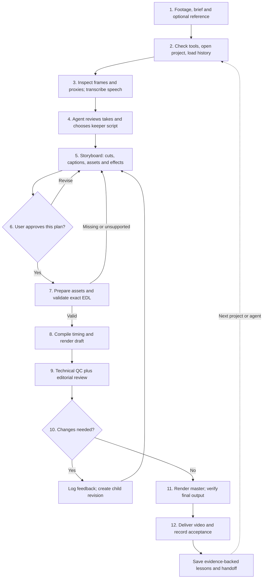

# Editing flow: from footage to delivered reel

This describes the current implementation after commit `b057f0e`. The tools execute a reviewed plan; an agent supplies editorial judgment and coordinates separate commands. There is not yet one autonomous job that performs every step, and the 31 effect demos are not all production-certified effects.

## End-to-end flow

If rendering fails, the run/command failure is retained. The next attempt starts from the recorded failure rather than overwriting it. Final upload to Instagram/YouTube is manual; there is no publishing integration in this flow.

## What happens at each step

| Step | Responsible | Actual output or behavior |
| --- | --- | --- |
| Intake | User + agent | Source location, audience, duration, message, CTA, style/reference and delivery requirements |
| Open/resume | Agent + CLI | `doctor`, `capabilities`, project metadata and `handoff` with unresolved feedback/recent failures/lessons |
| Understand footage | Tools + agent | ASR JSON/SRT, RMS timing hints, source-identified contact sheet, size-checked proxy parts; agent checks meaning and visuals |
| Keeper script | Agent + user review | Chosen takes and source ranges; `plan` can propose pause cuts but does not understand retakes, emphasis or narrative |
| Storyboard | Agent | Beat-by-beat explanation of spoken words, framing, graphic intent, assets, effect status and timing |
| Approval | User authorization + agent command | `approve` records the exact EDL content hash; changed plans require new approval |
| Asset preparation | Agent + optional providers | Actual screenshots, logos, clips, music/SFX, alpha cutouts and explicit compositions; optional services are not assumed available |
| Validate/compile | Tools | Check schema, source/asset existence, effect support, speed and ranges; map retained source intervals and captions into output time |
| Draft | Renderer | Swift/media/HyperFrames graphics, voice processing, music ducking/SFX and FFmpeg video; new revision/run IDs and logs |
| Review | Tools + agent/user | Automatic dimensions, FPS, duration and full-decode checks; visual/caption/audio/editorial judgment remains explicit |
| Master | Renderer + reviewer | Approved plan at requested delivery resolution/FPS; technically verify the actual master, not just the draft |
| Deliver/learn | Agent + user | File and version, acceptance decision, scoped lessons, history and next-agent handoff |

EDL means edit decision list: the machine-readable specification of what footage to keep and which effects/assets to place. Raw-time fields always refer to the original clip. The compiler handles output-time changes caused by cuts and speed.

## Feedback loop

Run and command history is automatic during rendering. Chat feedback, rejected creative ideas, review evidence and lessons must still be recorded through CLI commands by the agent; they are not captured automatically from arbitrary chat. A lesson is retrieved context, not a change to model weights. Recording a lesson ID does not prove the agent obeyed it; measurable rules need checks/tests.

The current project pointer means latest successfully rendered revision, not latest user-accepted revision. Use acceptance decision events to distinguish them. A dedicated accepted-master pointer would improve this.

## Folder responsibilities

| Location | Purpose |
| --- | --- |
| `raw/<Project>/` | Original footage |
| `transcripts/<Project>/` | ASR text and timing, plus local extracted audio |
| `assets/` | Reusable media; `audio` remains a compatibility symlink |
| `broll/<Project>/` | Project-specific media, alpha cutouts and prepared graphics |
| `projects/<id>/` | Project metadata, immutable submitted/compiled EDL snapshots, technical QC and append-only events |
| `renders/` | Generated sheets, proxies, drafts and final videos |
| `memory/` | Scoped lessons and preserved historical feedback |

Legacy one-project builders remain in `scripts/`; they were not all migrated or certified for new footage. New reusable features belong in `editor/`.

## Improvements to prioritize

1. **Prove one real reel end to end.** Review actual speech, captions, face clearance, audio and final delivery with a creator; close specific defects using revision evidence. Current automated tests primarily prove infrastructure.
2. **One resumable job command.** Coordinate ingest, transcription, planning artifacts, asset preparation, draft, QC and master; resume failures and cache unchanged segments/effects. Currently the agent runs separate commands and re-renders rather than performing selective invalidation.
3. **Semantic editorial planning.** Add structured keeper decisions, retake comparisons, hook/CTA alternatives and pause intent. Silence detection alone cannot choose the best take.
4. **A shared layer/sequence model for real effects.** Bind actual clips, masks, tracked subjects, captions and timed HUD state; certify reference fidelity per effect. Prioritize the synchronized proof-player format in the third reel before adding more disconnected demo scenes.
5. **Stronger acceptance gates.** Measure final loudness/true peaks; detect caption clipping, face/UI collisions, missing words, segmentation errors and unexpected freezes. Add an accepted-master pointer and explicit draft-to-master approval gate. Existing creative gates rely on the agent/user workflow rather than full mechanical enforcement.
6. **Easier feedback capture and better retrieval.** Attach chat feedback to revision/beat IDs automatically through an orchestrator or UI, retrieve relevant lessons by effect/creator, and run issue-specific regression checks. Current retrieval is scope-based and current feedback recording is explicit.
7. **Delivery packaging.** Export a cover/thumbnail, output-timed SRT/VTT, acceptance/version manifest and optional post copy. Current talking-head rendering delivers the video and history/QC artifacts; the ASR SRT still uses source time and is not automatically a valid subtitle file for the cut/speed-adjusted final video. Upload remains manual.
8. **Source compatibility and cleanup.** Test portrait rotation and hair/hands, add reviewed HDR-to-SDR conversion, document provider setup, and gradually retire fixed-path legacy scripts after regression coverage exists. Any agent can use the contract; execution is still macOS-specific.

## Suggested next milestone

Produce one 20–40-second talking-head reel using a reviewed keeper script, timed captions, two meaningful graphics, a clear CTA, technical plus creative QC, one deliberate feedback revision, and a verified handoff to another agent. This tests the complete operating flow with manageable creative scope.

Reference analysis: [third reel](reference/Def9pj5TWtA-analysis.md). Command details: [agent runbook](agent-runbook.md).
