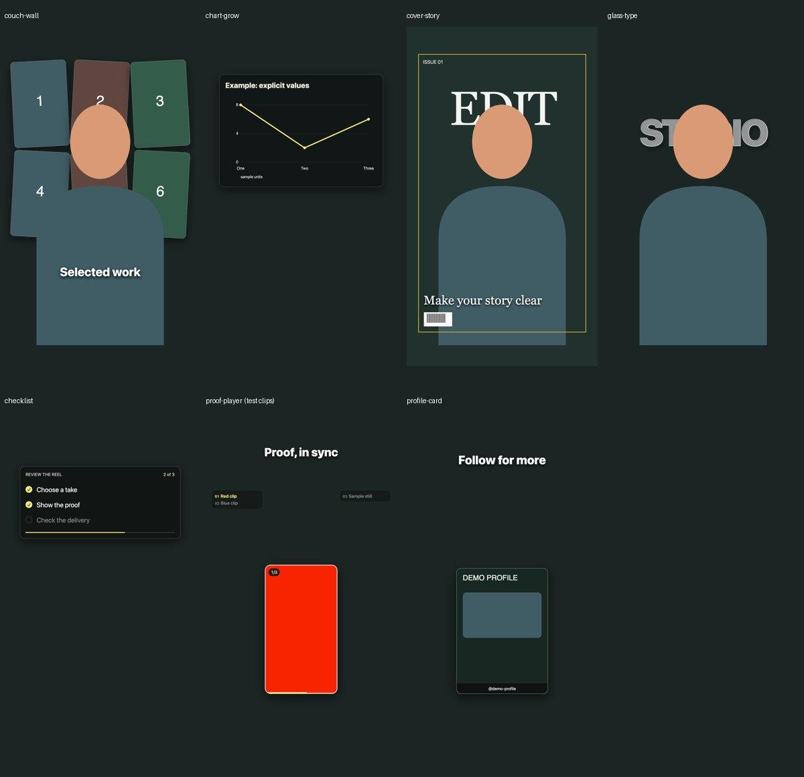

# Effect stockpile

The library contains **38 reusable compositions**: 31 previous scenes and seven additions from `igexport-Def9pj5TWtA.mp4`. All 17 named effects in that reel map to canonical entries. Similar reference labels do not imply identical implementations, and the library's experimental status remains visible.

## Seven additions

| Shortcut | What it does | Inputs and limits |
| --- | --- | --- |
| `@couch-wall` | Animates a wall of actual reel/photo cards behind a supplied subject layer | 1–9 media cards plus an aligned transparent subject. Does not create masks or clean background plates. |
| `@chart-grow` | Draws a line chart from explicit values, labels and units | 2–12 finite data values. Sample defaults are labeled example data. Minimum 2.6 seconds so the line/dots finish before exit. |
| `@cover-story` | Places a masthead behind the subject, with frame, cover line, issue label and decorative barcode in front | Actual alpha subject required; optional aligned background. Does not segment automatically. `magazine cover` is a lookup alias. |
| `@glass-type` | Translucent, embossed-looking display type with optional subject depth | Text, tint, size and optional alpha subject. This is a CSS visual approximation, not physical refraction. |
| `@checklist` | Glass task card with explicit completion times, ticks, count and progress | 1–8 tasks. Task checklist differs from the existing outer effect-index HUD. |
| `@proof-player` | Plays media in a rounded vertical viewport, synchronizing index, active row, counter and progress | Ordered non-overlapping local-time sequence entries with real sources. Supports an immediate frame-zero hook. Child audio is muted. |
| `@profile-card` | Animates an actual social profile screenshot with a supplied handle and CTA | Requires screenshot; does not invent metrics, follow anyone or send messages. |

These templates are tested compositions with supplied assets, not a certification of every reference's exact appearance or arbitrary creator footage. The original 31 scenes retain their existing fidelity notes. No production export is implied by stockpile preparation.

## Preview and evidence



These are validation fixtures, not claimed footage recreations. The proof-player tile uses colored clips to test actual switching. [Verification record](verification/stockpile-2026-10-29.json) covers the 46-test suite, seven scene browser/lint checks, a frame-zero case and rendered media pixels.

## Find an effect

```bash
python3 -m editor stockpile
python3 -m editor stockpile --effect "cover story"
python3 -m editor stockpile --effect "pull-back reveal"
```

Each result includes variables, required media, duration floor, source reference, approximate reference timestamp, occupancy zones and fidelity notes. The single source catalogue is `animations/_fx_library/registry.json`.

## Prepare a project-local composition

```bash
python3 -m editor stockpile --effect chart-grow \
  --output broll/MyReel/chart \
  --variables '{"title":"Example data","values":[5,12,20],"labels":["A","B","C"],"unit":"sample units"}'
```

Pass a JSON file instead of inline JSON for larger media/sequence inputs. `--project "My Reel"` resolves `@project/...` handles; `@asset/...` resolves the shared library. Ordinary text beginning with `@` remains text unless it uses an asset-handle prefix. Prepared media is copied locally and content-hashed; shared scenes remain unchanged. Existing destinations are never overwritten.

`--duration` changes the composition's hold window; fixed animation entrances/drawing speeds are not automatically stretched. Per-scene minimum durations prevent truncated animations. `proof-player` sequence and checklist times must fit inside the hold window and before the exit.

A proof-player variables file can contain:

```json
{
  "title": "Show the result",
  "sequence": [
    {"label":"Before","start":0.3,"duration":1.2,"src":"@project/broll/before.mp4","mediaStart":0},
    {"label":"After","start":1.5,"duration":1.2,"src":"@project/broll/after.mp4","mediaStart":0},
    {"label":"Evidence","start":2.7,"duration":1.2,"src":"@project/broll/result.png"}
  ]
}
```

`start` and `duration` are **composition-local** seconds. `mediaStart` trims into a child clip. The parent EDL's `start_raw` remains a source-video timestamp. One sequence drives every corresponding row, counter, progress bar and visible pane; there are no separate independent timing lists to drift apart.

The command prints structured render arguments and an EDL effect:

```json
{"type":"@hyperframes","composition":"broll/MyReel/chart","start_raw":4.0,"duration":3.0}
```

Use the actual output path printed by the command, set the intended source trigger, and review the storyboard before production rendering. Direct `@chart-grow` is a stockpile lookup name, not a silently expanded native EDL effect. Explicit compositions and their fidelity status remain visible to the agent.

## Reference coverage

| Reference label | Canonical stockpile entry |
| --- | --- |
| Orbit | `orbit` |
| Couch wall | `couch-wall` — new |
| UI world | `ui-world` |
| Frame break | `frame-break` |
| Digital zoom | `digital-zoom` |
| Phone mockup | `phone-mockup` |
| Checklist | `checklist` — new task variant |
| Headline wall | `headline-wall` |
| Zoom-through cut | `zoom-through` |
| Chart grow | `chart-grow` — new |
| Pull-back reveal | `pull-back` |
| Green screen | `green-screen` |
| Paper cut | `paper-cut` |
| Doodle boil | `doodle-boil` |
| Vertigo | `vertigo` |
| Cover story | `cover-story` — new layered variant |
| Glass type | `glass-type` — new approximation |

The overall proof player and closing profile CTA are additional composite patterns, separate from the 17 named inner demonstrations. Source anchors are approximate ASR/visual-review observations, not certified edit points. Full source analysis: [reference report](reference/Def9pj5TWtA-analysis.md).

## Reproduce validation

```bash
npm ci
python3 -m unittest discover -s tests -v
EDITOR_INTEGRATION=1 python3 -m unittest discover -s tests -v
python3 scripts/prepare_stockpile_validation.py
node scripts/verify_stockpile.cjs
./node_modules/.bin/hyperframes render renders/drafts/stockpile-validation/proof-player \
  --format mov --fps 15 --workers 2 --output renders/drafts/stockpile-validation/proof-player.mov
node scripts/verify_stockpile.cjs renders/drafts/stockpile-validation \
  renders/drafts/stockpile-validation/proof-player.mov
```

Fixture generation defaults to synthetic cards, vectors and colored test clips. `--reference` additionally exercises Apple Vision on the supplied reference reel; its pre-existing captions are baked into that source and may remain in the matte. Use clean raw footage for production masks. The helper only replaces its own marked validation directory when explicitly given `--replace`.

Browser checks cover actual asset loading, chart data, layer order, forward/backward seeking, shared proof-player state, frame-zero visibility and clean exits. Rendered pixel checks verify actual clip switching, rather than merely changing a text label. Glass refraction fidelity, arbitrary portrait masks and exact reference recreation remain creative-review work.
