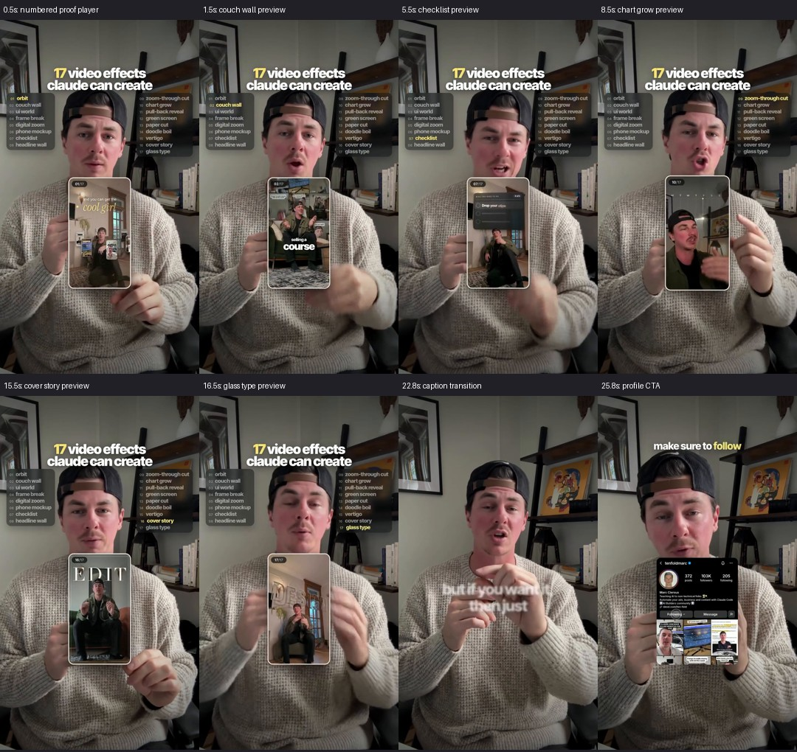

# Third reference reel: Def9pj5TWtA

Source: `examples/igexport-Def9pj5TWtA.mp4`. Duration **27.327 seconds**, **720×1280**, **30 fps**. This is an edited reference reel, not raw footage suitable for evaluating retake selection. Its dimensions do not constitute a native 4K source.

## Evidence and limits

Reviewed the locally generated faster-whisper transcript, full-duration 30-frame contact sheet and 20 selected original-resolution frames. Exact transitions, sound design and lip-sync were not certified by continuous audiovisual playback. Times below are approximate ASR/visual-review anchors, not frame-accurate effect in/out ranges. RMS adjustment is heuristic.

[Analysis manifest](Def9pj5TWtA-evidence/analysis-manifest.json) records source SHA256, sampling times, transcript path and limits. The generated 11,902,117-byte proxy passed its 14MB size budget. This host lacks FFmpeg drawtext, so the proxy has no burned timecode; the manifest preserves source offsets.

## Editorial structure

| Approximate time | What appears | Purpose and observations |
| --- | --- | --- |
| 0–16.6s | Persistent “17 video effects” hook, two checklist columns, active yellow row and a floating rounded vertical preview with an `n/17` counter | Demonstrates the claim while naming each effect. The presenter stays visible; the preview occupies torso space rather than covering the eyes. About one effect name per second creates a fast catalogue rhythm. |
| 16.6–21.7s | Showcase HUD/player clears; spoken release announcement and short white/yellow captions | Reduces visual complexity and shifts attention back to the offer. The spoken “26” refers to the planned release; it should not be mistaken for the number of previews in the opening montage. |
| 22.0–24.9s | Comment/waitlist instruction; emphasis on the comment keyword; social UI card appears in sampled frames around the CTA section | Converts the demonstration into one concrete action. Captions sometimes blur while moving; the sampled blur cannot establish its exact duration. |
| 25.1–27.3s | Follow request with profile card | Reinforces the action visually. A screenshot/reference profile is not an automated DM integration. |

## All 17 named effects and current-system mapping

The labels below are read from the on-screen checklist. ASR incorrectly wrote “Phone Markup”; the reviewed label is **phone mockup**. Similar names describe related visual intent, not equivalent implementations.

| # | Spoken/name anchor | Reference label | Current repository relationship |
| --- | --- | --- | --- |
| 1 | 0.07s | Orbit | Experimental `orbit` scene; a real foreground/reel depth sequence still needs certification |
| 2 | 0.90s | Couch wall | No exact named capability; related to real reel-card/background-grid composition, not merely a renamed placeholder |
| 3 | 1.62s | UI world | Experimental `ui-world`; bind actual UI/video content and review readability |
| 4 | 2.69s | Frame break | Experimental `frame-break`; full source-frame pullback/shatter is not certified |
| 5 | 3.50s | Digital zoom | Source segment zoom exists; experimental HUD scene is separate from a source-aware dynamic camera move |
| 6 | 4.59s | Phone mockup | Experimental `phone-mockup`; this reel also uses a phone-shaped player as the overall showcase container |
| 7 | 5.41s | Checklist | Related to `effect-hud`; in-player task checklist and outer effect index require separate state/layout |
| 8 | 6.36s | Headline wall | Experimental `headline-wall`; use reviewed copy or genuine sourced clippings |
| 9 | 7.40s | Zoom-through cut | Experimental `zoom-through`; actual outgoing/incoming source transition remains unverified |
| 10 | 8.77s | Chart grow | No exact named capability; sampled preview shows a line chart with weekday labels. No numerical data was established, so do not infer revenue/growth values |
| 11 | 9.51s | Pull-back reveal | Experimental `pull-back`; sampled reference includes actual video in a window and task/progress UI |
| 12 | 10.74s | Green screen | Segmentation tool plus experimental `green-screen`; replacement, edge quality and source synchronization need real-footage tests |
| 13 | 11.70s | Paper cut | Experimental `paper-cut`; paper styling is distinct from actual subject contour treatment |
| 14 | 12.80s | Doodle boil | Experimental `doodle-boil`; fixed SVG doodles are not tracked outlines around an arbitrary subject |
| 15 | 13.98s | Vertigo | Experimental `vertigo`; real background/foreground separation and clean plates are needed for convincing contrazoom |
| 16 | 14.73s | Cover story | Related to documented magazine-cover/depth title. A behind-head title primitive exists; complete cover layout/barcode/front-back choreography is not implemented as a certified capability |
| 17 | 15.68s | Glass type | No exact named capability; sampled preview shows large translucent/embossed-looking type. Exact refraction technique cannot be inferred from these frames |

## What is most useful to adopt

**A synchronized proof-player sequence is more valuable than 17 separate new shortcut names.** Use one effect ID to drive the spoken-word anchor, outer active checklist row, `n/17` counter and matching preview clip. Nested preview clips can carry their own local caption/effect timeline; the main presenter timeline remains independent.

Reusable layers would be: presenter base → optional behind-subject elements → subject foreground where needed → preview-player media → player frame/counter → checklist/title → captions/CTA. A single state table should schedule them so labels cannot drift from the visual proof. In the sampled 2.5s frame, the preview counter reads 04/17 while the outer checklist still highlights 03 UI world; this may be a transition boundary, so continuous frame review is needed before calling it a timing defect. It is a useful regression case for shared state. Pre-rendered effect examples can populate the player, while source-aware effects should remain separately certified.

This is a showcase format. A normal educational talking-head reel should borrow its proof, consistency and clear CTA rather than automatically copy its dense checklist and rapid succession of effects. The small preview's text is hard to read at phone size; fewer previews with longer holds would improve teaching value. The two dense checklist columns help catalogue navigation but may distract from a normal explanation.

## Improvements suggested by this reel

- Add a typed media-player/sequence primitive with rounded clipping, actual video, progress/counter and shared active-effect state.
- Keep outer and nested clip time separate; preserve spoken-word anchors when the main footage is cut or sped up.
- Create a data-backed chart primitive with explicit data/units rather than a decorative invented trend.
- Develop cover-story composition using explicit depth layers, and glass-type as an isolated visual treatment with honest approximation/fidelity status.
- Add viewport-scale readability and face/hand clearance checks. Treat caption blur as a brief transition, not a long reading state.
- Record each reference-derived idea in a reference brief; do not promote its music, creator branding or rapid montage pacing into universal editing rules.

## Suggested recreation order

1. First build the stable presenter + real preview player + synchronized counter/checklist + CTA.
2. Populate previews using verified prepared clips, avoiding the claim that a placeholder scene is a working source effect.
3. Certify the reusable chart, cover-story and glass-text treatments separately.
4. Only then compare an entire recreated reel against the reference with audiovisual review.

No new effect implementations or production render were created as part of this analysis. Project history records this reference review separately from creator edits; no new universal style lessons were promoted automatically.

## Stockpile implementation follow-up

The subsequent stockpile task added seven reusable compositions and canonical mappings for all 17 labels. See [effect stockpile](../effect-stockpile.md) and [generated preview sheet](Def9pj5TWtA-evidence/stockpile-previews.jpg). The original analysis above remains a record of the state before that implementation; the added glass treatment is an approximation, and mask-dependent effects require supplied alpha media.
