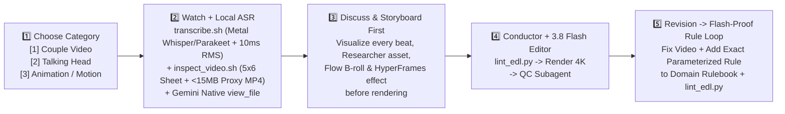

# Historical creative catalogue

These are editorial specifications and reference ideas. Executable support is reported by `python3 -m editor capabilities`. Experimental scenes are not certified implementations of every visual claim below. Commands and paths in the historical text may require migration; use the current runbook.

# AI Video Editor (`ai-editor`) — Conductor (`Gemini 4 Argon`) + Editor (`Gemini 3 Flash`) Master System

> **100% Free Local & Open-Source Video Production Stack on Apple Silicon M4**
> Built so **Gemini 4 Argon** acts as the **Conductor & Creative Director** (watching raw footage natively via `view_file`, designing storyboards, enforcing rules, and running QC) while **Gemini 3 Flash** (or any AI agent) acts as the **Fast Hands-On Video Editor** using deterministic `@shortcut` keywords, JSON templates, and modular rulebooks.

---

## 🧭 Quick Navigation
1. [Mandatory 4-Step Startup & Storyboard-First Flow](#-mandatory-4-step-startup--storyboard-first-flow)
2. [Step-by-Step Guidance for Every Scenario (Scenarios 1–4)](#-step-by-step-guidance-for-every-scenario)
   - [Scenario 1: Couple Video (`9:16 Vertical Game / Challenge`)](#scenario-1-couple-video-916-vertical-game--challenge--angel--arthur)
   - [Scenario 2: Talking Head (`FeedMedia Notion 14-Effect System + Antigravity M4`)](#scenario-2-talking-head-feedmedia-notion-14-effect-system--antigravity-m4)
   - [Scenario 3: Animation & Motion Graphics (`HyperFrames 4K & Vox Editorial Collage`)](#scenario-3-animation--motion-graphics-hyperframes-4k--vox-editorial-collage)
   - [Scenario 4: Generating AI Images & Videos with Google Flow MCP (`GTAI-1/flow-mcp`)](#scenario-4-generating-ai-images--videos-with-google-flow-mcp-gtai-1flow-mcp)
3. [Master `@shortcut` Keyword Dictionary (All 3 Categories)](#-master-shortcut-keyword-dictionary)
4. [Conductor (`Gemini 4 Argon`) + Editor (`Gemini 3 Flash`) Multi-Agent Guide](#-conductor-gemini-4-argon--editor-gemini-3-flash-multi-agent-guide)
5. [Repository Structure](#-repository-structure)

---

## 🚀 Mandatory 4-Step Startup & Storyboard-First Flow

Every new video project in this workspace follows this exact 4-step workflow:



1. **Step 1 — Pick Your Video Category (3 Options)**:
   When starting a conversation, choose:
   - **`[1] Couple Video`** (`9:16 Vertical Couple Game / Challenge` — `Angel` & `Arthur`)
   - **`[2] Talking Head`** (`Solo Creator / Tutorial / Demo` — **FeedMedia Notion 14-Effect System**)
   - **`[3] Animation / Motion Graphics`** (`HyperFrames 4K HTML/CSS/GSAP & Vox Editorial Paper Collage`)
2. **Step 2 — Watch the Video + Run Local Speech-to-Text**:
   The AI runs local Apple Silicon Metal speech-to-text with 10ms RMS acoustic onset verification (`./scripts/transcribe.sh`), generates both a full-duration 5×6 contact sheet and a `< 15 MB` 540p H.264+AAC **Vision Proxy MP4** (`./scripts/inspect_video.sh`), and watches + listens to the footage natively via `read_file` to summarize all takes and timestamps.
3. **Step 3 — Discuss & Describe Edits with `@shortcut` Keywords $\rightarrow$ Always Storyboard First**:
   You tell the AI what edits you want using the `@shortcut` keywords below. **Before rendering any video**, the AI **ALWAYS** builds the **Beat-by-Beat Storyboard Table** so you can visualize and approve every cut, text callout, Researcher screenshot, Google Flow asset, and HyperFrames motion graphic first.
4. **Step 4 — Lint & Render in Native 4K (`Conductor + 3.8 Flash Editor`)**:
   The Conductor validates the EDL via `scripts/lint_edl.py`, executes the 4K studio master render (directly or via a `Gemini 3.8 Flash` Editor subagent), and verifies 100% word/visual sync via QC.
5. **Step 5 — Mandatory Post-Render Revision $\rightarrow$ Flash-Proof Rule Training Loop**:
   At the end of every video, whenever you request a revision or fix, the AI:
   - **(a) Fixes & Re-Renders Immediately**
   - **(b) Writes a Flash-Proof Parameterized Rule** (exact pixel coordinates, font sizes, durations, dB levels, hex colors, and anti-patterns—never vague advice) into the category rulebook (`editing-rules-couple.md`, `editing-rules-talking-head.md`, or `editing-rules-animation.md`)
   - **(c) Adds a Pre-Render Check in `scripts/lint_edl.py`** and logs the lesson in `editing-rules.md` so **Gemini 3.8 Flash** is permanently trained and mechanically prevented from ever repeating that mistake.

---

## 🎬 Step-by-Step Guidance for Every Scenario

### Scenario 1: Couple Video (`9:16 Vertical Game / Challenge` — `Angel` & `Arthur`)

- **Rulebook Loaded**: [`.agents/skills/youtube-edit/references/editing-rules-couple.md`](../../.agents/skills/youtube-edit/references/editing-rules-couple.md) (`Rules C1–C15`)
- **Templates Used**: [`templates/01_couple_video/storyboard_template.md`](../../templates/01_couple_video/storyboard_template.md) · [`templates/01_couple_video/edl_template.json`](../../templates/01_couple_video/edl_template.json)

#### How to Run Scenario 1 Step-by-Step:
1. **Drop Raw Footage**: Place your raw vertical iPhone `.MOV` into `raw/<Project Name>/<clip>.MOV` (e.g., `raw/Tebak Gambar/IMG_0701.MOV`).
2. **Step 1 & 2 (AI Analysis)**: Tell the AI:
   > *"Category 1 (Couple Video). Analyze `raw/Tebak Gambar/IMG_0701.MOV`."*
   - The AI runs:
     ```bash
     ./scripts/transcribe.sh "raw/Tebak Gambar/IMG_0701.MOV" --lang id
     ./scripts/inspect_video.sh "raw/Tebak Gambar/IMG_0701.MOV" --table-crop
     ```
   - This produces 10ms RMS-snapped word timestamps with Stereo Left/Right speaker tags (`Angel` on Left `x=610`, `Arthur` on Right `x=1520`) plus both a full-frame contact sheet and a close-up `--table-crop` sheet of the cards/props on the table.
3. **Step 3 (Your `@shortcut` Prompt $\rightarrow$ Storyboard Table)**:
   Reply with the `@shortcut` keywords you want:
   > *"Build the storyboard first using:*
   > - *`@hook-bean-boozle` (`challenge` / `TEBAK GAMBAR 🔥`) from `0:00`*
   > - *`@wide` steady framing throughout + `@chopin-eb` background song*
   > - *`@one-word-captions` at the bottom*
   > - *`@timelapse-4x` with `@clock-tick` on the 30s memorization phase*
   > - *`@uncut-speed` (`1.30x–1.65x`) on card searching so the video stays under `< 2:30`*
   > - *`@header-cari` and `@header-dapat` on every turn*
   > - *`@bw-zoom-arthur` + `@meme-okay` when Arthur loses*
   > - *`@header-tally` during card counting and `@winner-parade` (`confetti_loop.mov` + `party_cheer.wav`) on the final count."*
4. **Step 4 (Approve Storyboard $\rightarrow$ 4K Master Render)**:
   - Review the Storyboard Table in chat. Once you say *"Approved, render it"*, the AI runs `scripts/lint_edl.py --category couple`, renders the **Native 4K (`2160×3840`) Studio Master** (`CRF 14`, `bt709`, `-14 LUFS`) + `*_cover.png` into `renders/final/<Project Name>/`, and runs the `caption-qc-reviewer` subagent check.

---

### Scenario 2: Talking Head (`FeedMedia Notion 14-Effect System via HyperFrames + Researcher + Google Flow`)

- **Rulebook Loaded**: [`.agents/skills/youtube-edit/references/editing-rules-talking-head.md`](../../.agents/skills/youtube-edit/references/editing-rules-talking-head.md) (`Rules TH1–TH25`)
- **Templates Used**: [`templates/02_talking_head/storyboard_template.md`](../../templates/02_talking_head/storyboard_template.md) · [`templates/02_talking_head/edl_template.json`](../../templates/02_talking_head/edl_template.json)
- **Why HyperFrames Replaces Remotion (and When `person_cutout.swift` Is Used)**:
  - In the FeedMedia Notion guide, the creator used **Remotion** (headless Chrome React/CSS) to render animated overlays. In our stack, **HyperFrames (`npx hyperframes` HTML/CSS/GSAP)** replaces Remotion **1-to-1** for all 14 Notion motion graphics (`@coral-captions`, `@tool-label`, `@repo-card`, `@prompt-bar`, `@color-slider`, `@moody-grade`, `@wall-of-reels`, `@pause-explain`, `@whip-pan`)—so we do **not** need static Swift PNG cards for Talking Head!
  - **Apple Vision (`scripts/person_cutout.swift`)** is used **strictly ONLY** when you want 3D depth sandwiching **behind your head** (`@text-behind-head` and `@magazine-cover`), matching the Notion guide's rule: *"For anything behind your head you need a person cutout. On a Mac it's built in: tell Claude to use Apple Vision person segmentation."*

#### The 5-Phase Talking Head Collaborative Flow:
1. **Phase 1 — Understand Raw Video**:
   Drop your clip into `raw/<Project Name>/<clip>.MOV`. The AI runs `./scripts/transcribe.sh --lang en` (10ms RMS onset) and `./scripts/inspect_video.sh` + `view_file` to watch your delivery and strip retakes (**Last-Take Wins**, `Rule TH2`).
2. **Phase 2 — Discuss & Align**:
   We review the cleaned keeper script, hook strategy, and where visual proof vs. motion graphics should land.
3. **Phase 3 — Unified Storyboard First (`Researcher + Google Flow MCP + HyperFrames`)**:
   Before any rendering, the AI presents the **Unified Storyboard Table** ([`templates/02_talking_head/storyboard_template.md`](../../templates/02_talking_head/storyboard_template.md)) mapping every beat to:
   - **Your Spoken Words & Smart Framing (`1.00x / 1.15x`)**
   - **🔎 Researcher (`capture_broll.mjs` / `yt-dlp`)**: Real 4K Retina screenshots of websites/repos/timelines, SVG tool logos, and reference reels.
   - **🎨 Google Flow MCP (`@flow-image` / `@flow-video`)**: Bespoke **Nano Banana / Imagen 4K** images or **Veo 3.1** cinematic B-roll metaphors ($0 API cost).
   - **⚡ HyperFrames (`npx hyperframes` HTML/CSS/GSAP)**: 60fps animated Notion effects (`@text-behind-head`, `@coral-captions`, `@tool-label`, `@repo-card`, `@prompt-bar`, `@moody-grade`, `@pause-explain`).
4. **Phase 4 — Build Assets & Render 60fps HyperFrames Motion Graphics**:
   Once you approve the Storyboard Table, the Researcher captures real screenshots/logos, Google Flow MCP generates bespoke B-roll, `npx hyperframes render` renders the 60fps HTML/CSS/GSAP animations, and `person_cutout.swift` runs only if `@text-behind-head` or `@magazine-cover` is used.
5. **Phase 5 — Master FFmpeg 4K Assembly & QC**:
   Assembles `< 0.22s` silence jump cuts (`1.00x / 1.15x` eye-line framing at `y=42%`), `-14 LUFS` voice + ducked BGM + 48kHz studio SFX into `renders/final/<Project Name>/` and runs QC verification.

---

### Scenario 3: Animation & Motion Graphics (`HyperFrames 4K & Vox Editorial Collage`)

- **Rulebook Loaded**: [`.agents/skills/youtube-edit/references/editing-rules-animation.md`](../../.agents/skills/youtube-edit/references/editing-rules-animation.md) (`Rules AM1–AM11`)
- **Templates Used**: [`templates/03_animation_motion_graphics/storyboard_template.md`](../../templates/03_animation_motion_graphics/storyboard_template.md) · [`templates/03_animation_motion_graphics/edl_template.json`](../../templates/03_animation_motion_graphics/edl_template.json)

#### How to Run Scenario 3 Step-by-Step:
1. **Provide Topic / Voiceover Script (or Existing Audio)**:
   Tell the AI:
   > *"Category 3 (Animation / Motion Graphics). Let's create a 60-second `@vox-collage` explainer (or `@tech-dark-4k` animation) on [Topic]. Start with the Storyboard Table."*
2. **Step 1 & 2 (Voiceover & Hybrid Asset Plan)**:
   - For Vox explainers, the AI writes a **zero-hyphen** documentary script (`"twenty two"`, `"twenty nine"`) and generates the British English neural voiceover (`@british-neural-vo` via `scripts/build_neural_vo.py`) + word-level timing (`scripts/generate_vo_timing.py`).
   - The AI presents the **Beat-by-Beat Animation Storyboard Table** ([`templates/03_animation_motion_graphics/storyboard_template.md`](../../templates/03_animation_motion_graphics/storyboard_template.md)) specifying:
     - **Clean Background Plate (`@empty-canvas`)**: Zero pre-baked moving subjects (`scripts/generate_clean_plates.py`).
     - **Search Real ($\ge 1000\text{px}$)**: Real historical/editorial photos fetched via `scripts/fetch_real_assets.py` (Wikimedia Commons / Openverse CC0) + mandatory **Unification Pass** (`@vox-cutout`: duotone + halftone dots + torn white paper border + drop shadow via `scripts/prepare_runner_cutouts.py`).
     - **Generate Bespoke (`@flow-image` / `@flow-video`)**: Bespoke metaphors or stylized elements generated via Google Flow MCP.
3. **Step 3 & 4 (HyperFrames Lint, Render & Multi-Stem Audio Mix)**:
   - After you approve the Storyboard Table, the AI builds the deterministic GSAP composition (`window.__timelines["main"] = gsap.timeline({ paused: true })`), runs:
     ```bash
     npx hyperframes lint animations/<Project>
     npx hyperframes render animations/<Project> --output renders/drafts/<Project>/animatic_raw.mp4
     ```
   - Extracts a visual contact sheet (`scripts/make_vox_contact_sheet.swift`) to verify zero overlapping elements via `view_file`, and runs `scripts/build_final_render.py` to mix `-14 LUFS` neural VO + ducked music + tactile paper foley (`paper_thock.wav`, `paper_slide.wav`, `marker_squeak.wav`).

---

### Scenario 4: Generating AI Images & Videos with Google Flow MCP (`GTAI-1/flow-mcp`)

Whenever any of the 3 video categories needs a **bespoke 4K B-roll image** (**Nano Banana / Imagen**) or an **AI video clip** (**Veo / Veo 3.1**) at **$0 API cost** using your Google account session:

#### Why We Use `GTAI-1/flow-mcp` (Our Recommended Engine)
Our subagent audited both [`GTAI-1/flow-mcp`](https://github.com/GTAI-1/flow-mcp) and [`miyakejima/google-flow-mcp`](https://github.com/miyakejima/google-flow-mcp):
- **`GTAI-1/flow-mcp` Wins on Zero-Friction Automation**: It connects directly to Google Chrome over the Chrome DevTools Protocol (`CDP port 9333`) with **zero unpacked Chrome extension required** and **zero 2-step manual extension handshakes**.
- **Clean 3-Tool Workflow**:
  1. `flow_status`: Checks your active Google Flow session and remaining free/subscription credits.
  2. `flow_generate`: Queues **Imagen / Nano Banana** images or **Veo 3.1** videos (`9:16` vertical or `16:9` horizontal, with optional reference images, start/end anchor frames, and `max_credits` safeguard).
  3. `flow_wait`: Waits for completion and **automatically downloads** the high-res PNG or MP4 directly into `broll/flow/`.

#### One-Time First Login for Google Flow MCP:
1. Run `flow_status` in Antigravity (or open `http://localhost:8787` when `flow-mcp` is active).
2. In the managed Chrome window that opens, sign into your Google account at `https://labs.google/fx/tools/flow`.
3. Your session cookies persist automatically in `~/.flow-mcp`—every future `@flow-image` or `@flow-video` request runs hands-free!

---

## ⌨️ Master `@shortcut` Keyword Dictionary

Use these `@shortcut` keywords in your prompts to trigger exact, deterministic effects across all 3 categories:

### Category 1: Couple Video Shortcuts (`editing-rules-couple.md` & `brand_kit.json`)
| `@shortcut` Keyword | Effect Description & Exact Parameters |
| :--- | :--- |
| **`@hook-bean-boozle`** | 2-line title (`challenge` in `HelveticaNeue-Bold 136pt` at `y=380` + `GAME NAME 🔥` in `Arial-Black 176pt` at `y=560` using 2-Pass Outer Stroke + Pure Fill) from `0:00:00`; saves `*_cover.png` (`Rules C2, C7, C18`). |
| **`@couple-hook-behind-head`** | Runs Apple Vision `scripts/person_cutout.swift` on the `0:00–3.5s` hook to sandwich the giant Game Title **behind Angel & Arthur's heads** for a 3D depth cover & intro (`Rule C20`). |
| **`@couple-speed-1.1x`** | Default **`1.10x` base speed** (`setpts=PTS/1.10` + `atempo=1.10`) on all normal dialogue/hook/guess segments with frame-quantized timestamp mapping so captions never drift (`Rule C16`). |
| **`@couple-grade`** | Mandatory 4K Warm Studio Color Grade (`curves` S-curve + warm skin-tone `colorbalance` + `eq=saturation=1.12:contrast=1.05` + 4K luma `unsharp`) applied across 100% of segments and cover (`Rule C17`). |
| **`@wide`** | Steady `1.00x` side-by-side framing showing both **Angel** (Left) and **Arthur** (Right) with zero jump-cut zoom alternation (`Rule C3`). |
| **`@one-word-captions`** | Pops strictly **one word at a time** at bottom (`PlayRes 2160x3840`, `Arial Black 116pt`, `y=3120`) with a 3-frame elastic spring pop (`0.72 -> 1.06 -> 1.00`) synced to 10ms RMS onset (`Rules C9, C19`). |
| **`@head-pop-angel`** / **`@head-pop-arthur`** | Pops bold letter/guess above Angel (`x=610, y=1020` @ 4K, `#FF6FAE`) or Arthur (`x=1520, y=1020` @ 4K, `#38BDF8`) on spoken onset + `pop.wav` for `1.4s–1.8s` max (`Rules C10, C18, C19`). |
| **`@top-word`** | Borderless completed-word callout (`API! 🔥`) at top (`y=470` @ 4K) strictly **after** the word is solved with `180ms` slide-down entrance, auto-hiding after `3.0s–4.0s` (`Rules C11, C19`). |
| **`@header-cari`** $\rightarrow$ **`@header-dapat`** | Turn-based card search header (`ARTHUR: CARI TRAKTOR BIRU 🚜` in `#FFFFFF`) that switches to `DAPAT` (`#4ADE80` + `correct_ding.wav`) **only** when the matching card is physically flipped (`Rules C11, C18`). |
| **`@flow-sticker-pop`** | Uses **Google Flow MCP** (`tools/flow-mcp`) to generate a 4K 3D die-cut sticker (`420×420px`) of funny guessed words/animals (`SANTET`, `ANJINGS`, `TRAKTOR BIRU`, `DUBAI CHOCOLATE`) popping in with `pop.wav` (`Rule C20`). |
| **`@flow-cutaway`** | Uses **Google Flow MCP** (**Veo 3.1**) to generate a `1.5s–2.2s` comedic visual cutaway on major verbal punchlines (`Rule C20`). |
| **`@timelapse-4x`** | Fast-forwards 30s memorization phase at **`4.0x` speed** with `clock_ticking.wav` and no bottom caption (`Rule C5`). |
| **`@uncut-speed`** | Preserves 100% uncut card placing/searching/flipping at `1.35x–1.70x` so the audience plays along mentally while finishing under `< 2:30` (`150s`) (`Rules C4, C5, C16`). |
| **`@bw-zoom-arthur`** / **`@bw-zoom-angel`** | Fast punch-in zoom (`1.15x -> 2.15x` in `0.17s`) + instant Black & White + Chopin Nocturne swell (`0.48`) on blunders/losses (`Rule C13`). |
| **`@meme-what`** / **`@meme-okay`** | Loss-only cutaway to 9:16 framed reaction meme (`What_ Meme.mp4` or `Hi! Okay,,,.mp4` `4.00s–6.64s`) with **`+14 dB` boost** and `0.03` music dip (`Rule C13`). |
| **`@header-tally`** $\rightarrow$ **`@winner-parade`** | Shows `HITUNG POIN! 🃏` (`#FFD60A`) during card counting, then triggers Winner Header + 4K 3D confetti (`confetti_loop.mov`, zero emojis over faces) + `party_cheer.wav` (`1.1x`) (`Rule C12`). |
| **`@chopin-eb`** | Permanent Couple Game background track: **Chopin Nocturne in E-flat major, Op. 9, No. 2** (`audio/music/nocturne_op9_in_eb.wav`) (`Rule C14`). |

### Category 2: Talking Head Shortcuts — Pack 1 (`editing-rules-talking-head.md` — FeedMedia Notion 14 Effects)
| `@shortcut` Keyword | Effect Description & Exact Parameters |
| :--- | :--- |
| **`@storyboard-first`** | *(Notion #1)* Generates the Beat-by-Beat Storyboard Table (`Time | Exact Words | @shortcut | Visual | Tool`) and waits for approval before rendering (`Rule TH1`). |
| **`@person-cutout`** | *(Notion Setup)* Apple Vision ANE (`VNGeneratePersonSegmentationRequest`) hardware person segmentation exporting a 4K `ProRes 4444` alpha matte via `scripts/person_cutout.swift` (`Rule TH9`). |
| **`@text-behind-head`** | *(Notion #2)* 2-line title (`150px`/`300px` @ 4K, `#F4F4F2`) placed **between** raw video and person cutout at **`20%` and `27%`** height (12f `cubic.out` rise `2%`, Line 2 delayed 4f) (`Rule TH10`). |
| **`@coral-captions`** | *(Notion #3)* `Helvetica Neue Bold` (`64px`/`128px` @ 4K, white, soft shadow) at **`61.5%`** height, up to **3 words at a time**, with a rounded Coral (`#D97757`, `8px`/`16px` radius) box **only on the active spoken word** (`Rule TH11`). |
| **`@tool-label`** | *(Notion #4)* App icon (`110px`/`220px`, rounded) fades up at **`61.5%`** height (12f `cubic.out`), then slides left while bold white name (`92px`/`184px`) slides out right (12f) + `pop.wav` (`Rule TH12`). |
| **`@repo-card`** | *(Notion #5)* GitHub Dark Theme card (`#0D1117`, **`85%` width**) rising `2%` over 12f (`cubic.out`) at top of frame with `owner/name`, `Public` badge, description, stars, and forks (`Rule TH13`). |
| **`@prompt-bar`** | *(Notion #6)* Reusable `#2B2B2B` pill bar (**`22.5%` height, `92.6%` width**) with white `Inter` typing text and `#D97757` coral send button + up-arrow (`Rule TH14`). |
| **`@color-slider`** | *(Notion #7)* Warm FFmpeg grade (`colorchannelmixer=rr=1.17:gg=1.10:bb=1.03,eq=saturation=1.12`) wiped right-to-left over **30 frames** (`ease-in-out cubic`) by a thin white vertical line (`Rule TH15`). |
| **`@magazine-cover`** | *(Notion #8)* Person cutout sandwich: cream serif masthead `"CLAUDE"` **behind** head + thin gold frame (`#D4AF37`), top-corner lines, and left barcode **in front**, popping in on stressed words (`Rule TH16`). |
| **`@real-screenshot`** | *(Notion #9)* Authentic 4K screenshot (`capture_broll.mjs`) fading up above head at **`90%` width**, rounded corners, soft shadow over 12 frames (`cubic.out`) (`Rule TH17`). |
| **`@whip-pan`** | *(Notion #10B)* Fast camera whip transition: last 6f of Shot A slide left `8%` + `50px` blur (`ease-in`); Shot B starts `8%` right + `50px` blur and settles over 6f (`cubic.out`) + `whoosh.wav` (`Rule TH18`). |
| **`@pip-zoom-3x`** | *(Notion #10A)* On `"this"`, shrinks shot into a picture-in-picture of itself **3 levels deep** above head, holds, then pushes through into the next shot (`Rule TH18`). |
| **`@moody-grade`** | *(Notion #11)* FFmpeg film curves + `-15%` saturation + vignette paired with a floating **Lightroom UI panel** (`Tone Curve`, `Basic`, `Effects`) whose sliders move as spoken (`Rule TH19`). |
| **`@wall-of-reels`** | *(Notion #12)* Shrinks speaker into the center tile of a **`3×3` grid** and pops 8 vertical reels (downloaded via `yt-dlp`) into the outer 8 tiles **1 per frame** (`Rule TH20`). |
| **`@pause-explain`** | *(Notion #13)* Top-left PIP clip (**`54%` width**) with corner timecode $\rightarrow$ freezes on `click.wav` $\rightarrow$ 10f later shrinks to **`24%` width** on left over 12f (`cubic.out`) while explaining $\rightarrow$ grows back (`Rule TH21`). |
| **`@jump-cuts`** | *(Notion #14)* Strips pauses `> 0.22s` (never inside a word) and alternates `1.00x` and `1.15x` (`y=42%` eye-line, auto-locking `1.00x` when top cards appear) (`Rules TH4, TH5`). |

### Category 2: Talking Head Shortcuts — Pack 2 (`De25fKeTRl7` 19 Effects in `animations/_fx_library/`)
| `@shortcut` Keyword | HyperFrames Template | Effect Description, Asset Handles & Exact Parameters |
| :--- | :--- | :--- |
| **`@effect-hud`** | `animations/_fx_library/effect-hud/` | Interactive on-screen Effect Checklist HUD synced to 10ms RMS onset (`timeline_tick.wav`). Supports `theme: "split-dark"` (2 dark glass columns `01–16`, `#F6E478` active highlight) and `theme: "sidebar-green"` (`#123024` right card, `#F0EADE` inverted active pill) (`Rule TH26`). |
| **`@keyword-captions`** | `animations/_fx_library/keyword-captions/` | Dual-theme Hook/CTA captions: `theme: "yellow-glow"` (white line 1 + `#F6E478` oversized keyword blurring in at `y=52%`) or `theme: "white-pill-stack"` (`#F6F0E4` stacked pills at `y=60%–66%` + `pop.wav`) (`Rule TH27`). |
| **`@headline-wall`** | `animations/_fx_library/headline-wall/` | Slams 3–4 torn-paper newspaper clippings (`#F0EADE`, Georgia serif, `±1.5°–4°` tilt) around the speaker + `#F6E478` yellow marker sweep across the hero headline + `@asset/audio/sfx/paper_thock.wav` (`Rule TH28`). |
| **`@zoom-through`** | `animations/_fx_library/zoom-through/` | Camera punch-through transition (`scale: 1.0 -> 6.5` in `0.28s power3.in`) + 2-frame `#FFFDF5` warm white flash $\rightarrow$ settles `1.8 -> 1.0` (`power3.out`) + `@asset/audio/sfx/whoosh.wav` (`Rule TH29`). |
| **`@vertigo`** | `animations/_fx_library/vertigo/` | Contrazoom / Dolly-Zoom: locks foreground `@project/cutout/...` at `1.02x` while scaling the background `1.00x -> 1.38x` over `1.20s` (`sine.inOut`) + `@asset/audio/sfx/whoosh.wav` (`Rule TH30`). |
| **`@green-screen`** | `animations/_fx_library/green-screen/` | Replaces background behind `@project/cutout/...` with `@asset/video/backgrounds/<clip>` or `@asset/video/memes/<clip>` via a 6-frame horizontal flash wipe + top `0.45` vignette (`Rule TH31`). |
| **`@phone-mockup`** | `animations/_fx_library/phone-mockup/` | Slides in 3D tilted `@asset/mockups/devices/iphone_16_pro_frame.svg` (`rotateY(14deg) rotateZ(-4deg)`) at `left=5%, top=30%` while scrolling `@asset/photo/screenshots/...` or `@asset/video/screen_recordings/...` inside (`Rule TH32`). |
| **`@digital-zoom`** | `animations/_fx_library/digital-zoom/` | Creeps zoom `1.00x -> 1.30x` (`y=42%`) with `style: "camcorder"` (face brackets + blinking `● REC` + `#F6E478` `1.30×` readout) or `style: "lens-ring"` (`#123024` focal dial sliding `85 -> 24 mm` in `#C6A254` gold) (`Rule TH33`). |
| **`@paper-cut`** | `animations/_fx_library/paper-cut/` | Wraps `@project/cutout/...` in a `14px` white torn-paper edge over `@asset/photo/textures/notebook_grid_paper.svg`, stamps ransom-note letter chips (`"PAPER / CUT"`, `stagger: 0.06s` + `paper_thock.wav`), and exits via vertical tear (`Rule TH34`). |
| **`@ui-world`** | `animations/_fx_library/ui-world/` | Floating 3D dark glassmorphism HUD around speaker: `PROMPT` card (`#F6E478` progress bar `scaleX: 0 -> 1`), `TIMELINE` thumbnail strip with sweeping playhead (`x: 40 -> 460px`), and `PREVIEW ● LIVE` card (`Rule TH35`). |
| **`@orbit`** | `animations/_fx_library/orbit/` | 3D horizontal carousel ring (`perspective: 1400px`, `translateZ(380px)`) of vertical reels (`@asset/video/reels/`) orbiting `rotationY: -35deg -> 145deg` behind and in front of `@project/cutout/...` (`Rule TH36`). |
| **`@frame-break`** | `animations/_fx_library/frame-break/` | Pulls active shot into a `64%` Instagram Reel UI frame (heart/comment/share icons, `@handle · Follow`) while polygonal glass shards shatter radially outward + `@asset/audio/sfx/sub_drop.wav` (`Rule TH37`). |
| **`@doodle-boil`** | `animations/_fx_library/doodle-boil/` | Self-tracing neon/chalk SVG outline (`#FFFFFF` + `#F6E478`) around `@project/cutout/...` silhouette + `#FF7EB6`/`#38BDF8` spark rings boiling with `steps(2)` at `12fps` + `marker_squeak.wav` (`Rule TH38`). |
| **`@sticky-text`** | `animations/_fx_library/sticky-text/` | Detaches the active item from `@effect-hud`, flies it down (`back.out(1.7)`), and slaps it at `top=58%, left=48%` as a tilted `-5.5°` `#F6E478` yellow sticker pill + `pop.wav` (`Rule TH39`). |
| **`@before-after`** | `animations/_fx_library/before-after/` | Sweeps a vertical glowing light-leak beam (`x: 40 -> 1020px` in `1.35s power2.inOut`) separating flat `"before"` footage on the left from warm graded `"• after"` footage on the right (`Rule TH40`). |
| **`@pull-back`** | `animations/_fx_library/pull-back/` | Pulls frame back in 3D (`rotationX: 8deg, rotationY: -10deg`) inside a `92%×78%` `#0B0D12` NLE window (`"effects reel"`), ticking off `✓ cut pauses / ✓ add effects / ✓ export` above a colored clip timeline (`Rule TH41`). |
| **`@depth-scatter`** | `animations/_fx_library/depth-scatter/` | Multi-plane 3D Z-depth scatter with `@project/cutout/...`: white `"depth"` (`210px`/`420px`) assembles **behind** head (`top=24%`) while `#F6E478` `"scatter"` (`196px`/`392px`) assembles **in front** (`top=44%`) with rack-focus blur (`Rule TH42`). |
| **`@reel-grid`** | `animations/_fx_library/reel-grid/` | Unified multi-reel grid (`@asset/video/reels/` & `@asset/photo/thumbnails/`) supporting 4 modes: `background` (4×4 wall behind cutout), `collapse` (3×3 radial fly-out), `playing` (3×2 live grid), and `cascade` (4×2 staggered pop) (`Rule TH43`). |
| **`@comment-bubble`** | `animations/_fx_library/comment-bubble/` | Social CTA Comment-to-DM funnel (`bottom=14%`): dark `#F6E478`-bordered input types keyword (`"STUDIO"`/`"EDIT"`) $\rightarrow$ morphs into white `"you · STUDIO ❤️"` bubble $\rightarrow$ slides in `"Sent you the link"` + `"🔗 Open link"` button (`Rule TH44`). |

### Category 2: Talking Head Shortcuts — Pack 3 (`De4UDEqM1f5` 12 Editorial & NLE Effects in `animations/_fx_library/`)
| `@shortcut` Keyword | HyperFrames Template | Effect Description, Asset Handles & Exact Parameters |
| :--- | :--- | :--- |
| **`@knockout-captions`** | `animations/_fx_library/knockout-captions/` | At `top=10%, left=4%, width=60%`, shows `#123024` green intro pills, then slams a `#F0EADE` cream card with `168px` Georgia Black `"KNOCK / OUT"` knocked out as a transparent stencil window + `sub_drop.wav` (`Rule TH45`). |
| **`@live-markup`** | `animations/_fx_library/live-markup/` | Self-tracing `#C06672` rose-pink hand-drawn SVG circle (`stroke-dashoffset: 1400 -> 0` in `0.45s`) around the speaker's head + curved arrow and italic `"markup"` callout + `marker_squeak.wav` (`Rule TH46`). |
| **`@film-look`** | `animations/_fx_library/film-look/` | Sweeps a `6px` `#F0EADE` horizontal scanline (`y: 120 -> 1760px` in `1.10s`) wiping in a 16mm Kodak film grade + `@asset/video/overlays/film_grain_16mm.mov` (`Rule TH47`). |
| **`@jiggle-delete`** | `animations/_fx_library/jiggle-delete/` | `#F0EADE` cream iOS `"EDIT MODE"` card (`top=56%`) where 4 competitor app icons (`@asset/logos/apps/capcut.svg`, `edits.svg`, `inshot.svg`, `premiere.svg`) jiggle (`±3°`) and pop-delete one-by-one + `pop.wav` (`Rule TH48`). |
| **`@screenplay-page`** | `animations/_fx_library/screenplay-page/` | Slides in a `66%`-width `#F0EADE` Courier screenplay page (`INT. GREEN ROOM - DAY`, character cue, dialogue) from the left and sweeps a `#F6E478` highlighter across the spoken effect name (`Rule TH49`). |
| **`@contact-sheet-hook`** | `animations/_fx_library/contact-sheet-hook/` | Forest-green (`#123024`) numbered 4×4 contact sheet (`width=62%`) with `#F0EADE` serif `"CONTACT SHEET"` + `#C6A254` gold `"HOOK"`, stamping thumbnails (`@asset/photo/thumbnails/`) into cells `01 -> 16` (`Rule TH50`). |
| **`@keycaps`** | `animations/_fx_library/keycaps/` | Drops 6 bevelled `#F0EADE` 3D Mac shortcut keycaps (`⌘K`, `⌘B`, `⌘Z`, `space`, `J`, `L`) with `bounce.out` physics above the speaker's head (`top=14%–30%`) + `click.wav` (`Rule TH51`). |
| **`@nle-timeline`** | `animations/_fx_library/nle-timeline/` | Floating `#0E221A` dark-green NLE timeline strip (`bottom=16%, left=4%, right=4%`) with `#F0EADE` clip blocks, green waveform, and a white playhead sweeping `x: 60 -> 880px` (`Rule TH52`). |
| **`@serif-stamp`** | `animations/_fx_library/serif-stamp/` | Fades in `#C6A254` gold italic `"serif"` (`64px`), then stamps `#F0EADE` cream uppercase Georgia letters (`"S T A M P"`, `164px`/`328px`) letter-by-letter (`scale: 1.45 -> 1.0`, `stagger: 0.06s` + `paper_thock.wav`) (`Rule TH53`). |
| **`@icon-strike`** | `animations/_fx_library/icon-strike/` | Pops competitor app icons (`@asset/logos/apps/capcut.svg`, `edits.svg`) at `top=24%`, slashes each with a `#C06672` rose-pink diagonal X (`marker_squeak.wav`), shows italic `"strike."`, and drops them with gravity (`Rule TH54`). |
| **`@grease-pencil`** | `animations/_fx_library/grease-pencil/` | `#F0EADE` 3-row sprocketed film contact sheet (`top=12%, left=4%, width=60%`) with `#C06672` italic `"dead air"` header, slashing bad takes with `#C06672` grease-pencil `✕` marks (`Rule TH55`). |
| **`@video-card`** | `animations/_fx_library/video-card/` | `60%`-width split glass chapter card (`top=14%, left=4%`): top half shows raw-vs-finished split preview + play button; bottom `#123024` green banner displays `"Video card"`, `#4ADE80` active chapter, and `#C6A254` pill (`Rule TH56`). |

### Category 3: Animation & Motion Graphics Shortcuts (`editing-rules-animation.md`)
| `@shortcut` Keyword | Effect Description & Exact Parameters |
| :--- | :--- |
| **`@vox-collage`** | Tactile editorial paper-collage aesthetic (`#F4EDDE` cream paper, `#191713` ink borders, halftone textures, `steps(3)` stop-motion strides) (`Rules AM2, AM7`). |
| **`@vox-cutout`** | Searches real archival human/object photography ($\ge 1000\text{px}$) and applies the mandatory **Unification Pass** (`duotone` + `halftone` + `torn white paper edge` + `drop shadow`) (`Rules AM7, AM8`). |
| **`@empty-canvas`** | Starts every beat at `0.00s` on a clean background plate (`generate_clean_plates.py`) and animates all subjects entering dynamically (`Rule AM9`). |
| **`@paper-banner-captions`** | Cream paper caption banner (`#F4EDDE`) with dark ink border (`#191713`) and Vox yellow marker highlight (`#FFD51F`) sweeping across active words (`Rule AM7`). |
| **`@unequal-lines`** | Animates 5 distinct colored starting lines (**Yellow, Red, Coral, Teal, Navy**) across staggered lanes (`Rule AM11`). |
| **`@british-neural-vo`** | Natural British English neural voiceover (`en-GB-RyanNeural`) with **zero hyphens** in numbers (`"twenty two"`) (`Rule AM7`). |
| **`@tech-dark-4k`** | 4K dark-mode kinetic typography & data visualization (`#0A0D14` bg, `#38BDF8` sky, `#FACC15` gold, `#4ADE80` green, 10% safe margins) (`Rules AM1–AM6`). |

### Universal Shortcuts (`editing-rules.md`)
| `@shortcut` Keyword | Effect Description |
| :--- | :--- |
| **`@flow-image`** / **`@flow-video`** | Generates 4K B-roll images (**Nano Banana / Imagen**) or video clips (**Veo 3.1**) at $0 API cost via **Google Flow MCP** (`tools/flow-mcp`). |
| **`@free-bgm`** | Searches and downloads CC0 / royalty-free music via `free-audio` MCP (`scripts/free_audio_mcp.mjs`). |
| **`@master-4k`** | Encodes Native 4K (`2160×3840` or `3840×2160`) H.264 High@L5.2, `-preset slow -crf 14`, `45–50 Mbps`, `bt709`, `-14 LUFS` voice, `normalize=0` (`Rules U4, U6`). |
| **`@qc-check`** | Runs `lint_edl.py` + `inspect_video.sh` + `view_file` + `caption-qc-reviewer` subagent verification (`Rules U2, U7`). |

---

## 🗂️ Strict Two-Handle Studio Asset System (`@asset/...` & `@project/...`)

Every AI agent (Conductor or Editor) **MUST** resolve and store all videos, photos, reels, backgrounds, logos, mockups, and audio using the **Two-Handle System** ([`assets/README.md`](../../assets/README.md) & [`assets/manifest.json`](../../assets/manifest.json)):

### 1. Handle #1 — `@asset/<type>/<category>/<file>` (Global Reusable Studio Library in `assets/`)
| Handle Prefix | Physical Folder | What Lives Here & Which `@shortcut` Uses It |
| :--- | :--- | :--- |
| **`@asset/video/backgrounds/`** | `assets/video/backgrounds/` | Loopable studio backgrounds & `@green-screen` replacement plates. |
| **`@asset/video/reels/`** | `assets/video/reels/` | Vertical 9:16 reference reels (`@orbit`, `@reel-grid`, `@wall-of-reels`). |
| **`@asset/video/broll/`** | `assets/video/broll/` | Reusable cinematic B-roll & Google Flow (**Veo 3.1**) clips (`@flow-video`). |
| **`@asset/video/memes/`** | `assets/video/memes/` | Reaction memes & comedy green-screen clips (`@meme-what`, `@meme-okay`, `@green-screen`). |
| **`@asset/video/overlays/`** | `assets/video/overlays/` | ProRes 4444 confetti, 16mm film grain (`@film-look`), light leaks, glass shards (`@frame-break`). |
| **`@asset/video/screen_recordings/`** | `assets/video/screen_recordings/` | Scrolling UI & app recordings (`@phone-mockup`, `@pause-explain`). |
| **`@asset/photo/backgrounds/`** | `assets/photo/backgrounds/` | High-res ($\ge 1000\text{px}$) room, wall, & paper plates (`@green-screen`, `@vox-collage`). |
| **`@asset/photo/screenshots/`** | `assets/photo/screenshots/` | Authentic 4K Retina web/repo screenshots from `scripts/capture_broll.mjs` (`@real-screenshot`, `@phone-mockup`). |
| **`@asset/photo/textures/`** | `assets/photo/textures/` | Cream paper (`#F0EADE`), notebook grid paper (`@paper-cut`, `@headline-wall`, `@screenplay-page`). |
| **`@asset/photo/headlines/`** | `assets/photo/headlines/` | Newspaper & article clipping cards (`@headline-wall`). |
| **`@asset/photo/thumbnails/`** | `assets/photo/thumbnails/` | Vertical reel cover frames (`@reel-grid`, `@contact-sheet-hook`, `@video-card`). |
| **`@asset/logos/apps/`** | `assets/logos/apps/` | App SVG/PNG icons (`capcut.svg`, `edits.svg`, `inshot.svg`, `premiere.svg`, `ffmpeg.svg`, `claude.svg` for `@tool-label`, `@jiggle-delete`, `@icon-strike`). |
| **`@asset/mockups/devices/`** | `assets/mockups/devices/` | Device frames (`iphone_16_pro_frame.svg` for `@phone-mockup`). |
| **`@asset/audio/sfx/`** | `assets/audio/sfx/` (`audio/sfx/`) | 48kHz studio foley (`pop.wav`, `whoosh.wav`, `click.wav`, `sub_drop.wav`, `paper_thock.wav`, `paper_slide.wav`, `marker_squeak.wav`, `timeline_tick.wav`). |
| **`@asset/audio/music/`** | `assets/audio/music/` (`audio/music/`) | Royalty-free music beds (`nocturne_op9_in_eb.wav` & `free-audio` MCP tracks). |

### 2. Handle #2 — `@project/<type>/<file>` (Per-Project Scoped Assets)
| Handle Prefix | Physical Folder | What Lives Here |
| :--- | :--- | :--- |
| **`@project/raw/<clip>`** | `raw/<Project Name>/<clip>` | Raw camera `.MOV` / `.MP4` source footage. |
| **`@project/cutout/<name>.mov`** | `broll/<Project Name>/<name>.mov` | Apple Vision ProRes 4444 (`yuva444p10le`) person cutout from `scripts/person_cutout.swift`. |
| **`@project/broll/<file>`** | `broll/<Project Name>/<file>` | Project-specific HyperFrames `.mov`/`.webm` renders, Flow AI clips, & captured screenshots. |
| **`@project/transcript/<file>`** | `transcripts/<Project Name>/<file>` | 10ms RMS acoustic onset JSON (`*_acoustic.json`) & SRT files. |

---

## 🤝 Conductor (`Gemini 4 Argon`) + Editor (`Gemini 3 Flash`) Multi-Agent Guide

This repository is engineered so two tiers of Gemini models can collaborate seamlessly:
1. **The Conductor (`Gemini 4 Argon`)**:
   - Handles **Steps 1, 2 & 3**: Asks for the video category, inspects the raw video and contact sheet via multimodal `view_file`, designs the **Storyboard Table**, compiles the declarative `edl.json`, and runs `python3 ./scripts/lint_edl.py`.
2. **The Editor (`Gemini 3 Flash` via `invoke_subagent(Model="flash")`)**:
   - Handles **Step 4**: Because every effect is parameterized in `edl.json` and backed by deterministic CLI scripts (`scripts/person_cutout.swift`, `scripts/talking_head_overlays.swift`, `scripts/talking_head_engine.py`, `npx hyperframes`), the fast Flash agent can execute the heavy rendering commands and return the finished MP4 path to the Conductor for final QC.

---

## 📁 Repository Structure

```text
AI_Video_Editor_Gemini/
├── README.md                                  # Master Scenario Guide, Dual-Handle Asset Map & @shortcut Dictionary
├── GEMINI.md                                  # Always-On Conductor & Editor Rules for Antigravity
├── assets/                                    # Handle #1 (@asset/...): Canonical Studio Asset Library
│   ├── README.md                              # Strict Dual-Handle Asset Guide & Sourcing Fallbacks
│   ├── manifest.json                          # Machine-Readable Dual-Handle Registry
│   ├── video/                                 # backgrounds/, reels/, broll/, memes/, overlays/, screen_recordings/
│   ├── photo/                                 # backgrounds/, screenshots/, textures/, people/, headlines/, thumbnails/
│   ├── logos/                                 # apps/ (capcut, edits, inshot, premiere, ffmpeg, claude), brands/
│   ├── mockups/                               # devices/ (iphone_16_pro_frame.svg), ui/
│   ├── audio/                                 # sfx/ (17 studio 48kHz WAVs) & music/ (also symlinked at ./audio)
│   └── fonts/                                 # Local display, serif & monospace fonts
├── animations/
│   ├── _fx_library/                           # 31 Lint-Verified HyperFrames Templates (Pack 2 & Pack 3) + registry.json
│   └── hook_title/                            # Sample 4K Hook Title Composition
├── .agents/skills/
│   ├── youtube-edit/
│   │   ├── SKILL.md                           # 4-Step Storyboard-First Execution Runbook
│   │   └── references/
│   │       ├── editing-rules.md               # Master Router, Universal Rules (U1-U8) & Changelog
│   │       ├── editing-rules-couple.md        # Category 1: Couple Video Rules (C1-C20)
│   │       ├── editing-rules-talking-head.md  # Category 2: Talking Head Rules (TH1-TH56: Pack 1 + Pack 2 + Pack 3)
│   │       └── editing-rules-animation.md     # Category 3: HyperFrames 4K & Vox Collage Rules (AM1-AM11)
│   └── hyperframes/
│       └── SKILL.md                           # HyperFrames Deterministic HTML/CSS/GSAP Guide
├── templates/
│   ├── 01_couple_video/                       # Category 1: Couple Game EDL & Storyboard Templates
│   ├── 02_talking_head/                       # Category 2: Talking Head EDL & Storyboard Templates
│   └── 03_animation_motion_graphics/          # Category 3: HyperFrames / Vox EDL & Storyboard Templates
├── tools/
│   └── flow-mcp/                              # GTAI-1/flow-mcp Google Flow Image/Video MCP Server
└── scripts/
    ├── transcribe.sh                          # Parakeet (EN) / Whisper (ID) + 10ms RMS Acoustic Onset
    ├── acoustic_onset.py                      # 10ms RMS Onset Snapper + Stereo L/R Speaker Diarization
    ├── inspect_video.sh                       # Full-Duration 5x6 Contact Sheet + <15MB Vision Proxy MP4
    ├── lint_edl.py                            # Pre-Render Rule Linter across all 3 Categories (incl. TH25A-TH56)
    ├── build_fx_library.py                    # Deterministic Builder for assets/ & animations/_fx_library/
    ├── person_cutout.swift                    # Apple Vision ANE Person Cutout -> ProRes 4444 (.mov)
    ├── talking_head_overlays.swift            # Native 4K CoreText/AppKit Notion Effect Overlays
    ├── talking_head_engine.py                 # Declarative Talking Head Master Builder (Pack 1, 2 & 3 + Dual Handles)
    ├── capture_broll.mjs                      # Headless Chrome 4K Retina Screenshot Capture
    └── free_audio_mcp.mjs                     # 100% Free Audio MCP (Openverse + yt-dlp + Studio SFX)
```
