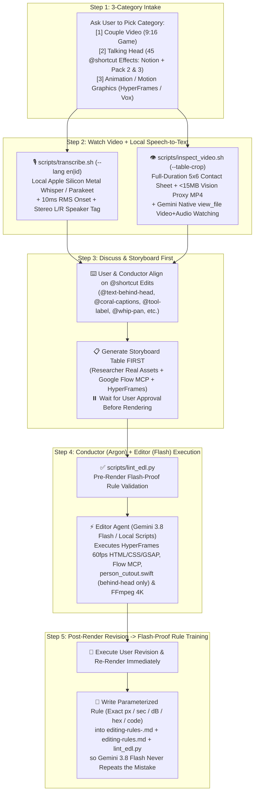

# Historical agent instructions (superseded)

Use the current model-neutral runbook. This copy preserves prior workflow context and does not define executable capabilities.

# AI Video Editor — Gemini 4 Argon (Conductor) + Gemini 3 Flash (Editor) Master System

> **Master Reference & `@shortcut` Dictionary**: Always read [`README.md`](../../README.md) for the complete `@shortcut` Keyword Dictionary and 3-Category Template structure.

---

## 1. Conductor + Editor Multi-Agent Architecture



---

## 2. Mandatory Always-On Rules for the AI Conductor & Editor

### Rule A: Every New Project Conversation Starts With the 3-Category Choice & Storyboard First
1. **Step 1 — Offer the 3 Video Categories**:
   Whenever starting a new video project or conversation in this workspace, ask the user which of the **3 Categories** we are building (if not already specified):
   - **`[1] Couple Video`** (`9:16 Vertical Game / Challenge` — loads [`.agents/skills/youtube-edit/references/editing-rules-couple.md`](../../.agents/skills/youtube-edit/references/editing-rules-couple.md) & [`templates/01_couple_video/`](../../templates/01_couple_video/))
   - **`[2] Talking Head`** (`Solo Creator + 45 @shortcut Effect System (Pack 1 Notion 14 + Pack 2 De25fKeTRl7 19 + Pack 3 De4UDEqM1f5 12)` — loads [`.agents/skills/youtube-edit/references/editing-rules-talking-head.md`](../../.agents/skills/youtube-edit/references/editing-rules-talking-head.md), [`templates/02_talking_head/`](../../templates/02_talking_head/), and [`animations/_fx_library/`](../../animations/_fx_library/))
   - **`[3] Animation / Motion Graphics`** (`HyperFrames 4K & Vox Editorial Collage` — loads [`.agents/skills/youtube-edit/references/editing-rules-animation.md`](../../.agents/skills/youtube-edit/references/editing-rules-animation.md) & [`templates/03_animation_motion_graphics/`](../../templates/03_animation_motion_graphics/))
2. **Step 2 — Watch the Video + Run Local Speech-to-Text First**:
   - Run `./scripts/transcribe.sh "raw/<Project>/<clip>.MOV" --lang en|id` (runs local Apple Silicon Metal Whisper `small.en` / `base` or `parakeet-mlx` offline + [`scripts/acoustic_onset.py`](../../scripts/acoustic_onset.py) for 10ms RMS onset snapping and Left/Right speaker tagging).
   - Run `./scripts/inspect_video.sh "raw/<Project>/<clip>.MOV"` (adding `--table-crop` for card/prop games), which generates **both** `renders/drafts/<clip>_contact_sheet.jpg` **and** a lightweight `< 15 MB` `renders/drafts/<clip>_vision_proxy.mp4` (`540p H.264 + AAC` with burned timecode).
   - **Always call `read_file` on both `<clip>_contact_sheet.jpg` AND `<clip>_vision_proxy.mp4`** so you genuinely watch and hear the full video (even when the raw 4K `.MOV` exceeds `100 MB`).
   - Present a crisp summary of the raw footage takes and timestamps so the user can discuss and specify edits using the `@shortcut` keywords in [`README.md`](../../README.md).
3. **Step 3 — ALWAYS Present the Storyboard Table Before Rendering**:
   - Translate the user's requested `@shortcut` edits into the category's **Beat-by-Beat Storyboard Table** (`templates/0X_.../storyboard_template.md`) so the user can visualize every beat, spoken line, Researcher screenshot, Google Flow asset, and HyperFrames motion graphic before rendering.
4. **Step 4 — Conductor (`Gemini 4 Argon`) + Editor (`Gemini 3 / 3.8 Flash`) Division of Labor**:
   - **Gemini 4 Argon (The Conductor / Creative Director)** watches the video, designs the Storyboard and EDL JSON, runs `python3 ./scripts/lint_edl.py`, and verifies the final render.
   - **Gemini 3 / 3.8 Flash (The Editor)** can be invoked via `invoke_subagent(Model="flash")` (or run directly) to execute the deterministic HyperFrames/Swift/Python/FFmpeg scripts following the exact `@shortcut` specifications in [`README.md`](../../README.md).

### Rule B: Image & Video Generation via Google Flow MCP (`GTAI-1/flow-mcp`)
Whenever bespoke B-roll images (**Nano Banana / Imagen 4K**) or AI video clips (**Veo 3.1**) are needed (`@flow-image` / `@flow-video`), use the configured **Google Flow MCP** (`tools/flow-mcp`) to generate assets at $0 API cost into `broll/flow/`, applying the mandatory unification pass when used in Vox-style explainers.

### Rule C: Mandatory End-of-Video Revision $\rightarrow$ Flash-Proof Rule & Linter Training Protocol (NEVER SKIP)
Because **Gemini 3.8 Flash** is a lighter, faster model than **Gemini 4 Argon**, it cannot rely on vague aesthetic judgment—it requires **explicit, parameterized rules and automated linter checks**. Therefore, at the end of every video when the user gives a revision or fix:
1. **Execute the Revision Immediately** and re-render the video.
2. **Write a Flash-Proof Parameterized Rule** into the matching domain rulebook ([`editing-rules-couple.md`](../../.agents/skills/youtube-edit/references/editing-rules-couple.md), [`editing-rules-talking-head.md`](../../.agents/skills/youtube-edit/references/editing-rules-talking-head.md), or [`editing-rules-animation.md`](../../.agents/skills/youtube-edit/references/editing-rules-animation.md)):
   - Never write vague advice (*"make captions look better"* or *"don't overlap"*).
   - Always write **Anti-Pattern vs. Exact Numbers** (exact pixel coordinates, font size, hex color, duration in seconds, dB level, or exact FFmpeg/GSAP formula).
3. **Add a Mechanical Check to [`scripts/lint_edl.py`](../../scripts/lint_edl.py)** whenever the revision involves a measurable constraint (duration, zoom vs. top-card collision, word count, safe zone, audio level) so Flash is blocked from repeating the mistake pre-render.
4. **Log in the Master Feedback Changelog & `@shortcut` Dictionary**:
   - Append the revision to the **Master Feedback Changelog** at the bottom of [`.agents/skills/youtube-edit/references/editing-rules.md`](../../.agents/skills/youtube-edit/references/editing-rules.md) and update [`README.md`](../../README.md) if a new `@shortcut` was added or refined.

### Rule D: Environment PATH & Per-Project Folder Organization
- Always ensure Homebrew and local binaries are on `PATH`:
  ```bash
  export PATH="/opt/homebrew/bin:/usr/local/bin:$HOME/.local/bin:$PATH"
  ```
- Always mirror `raw/<Project Name>/` across `renders/final/<Project Name>/`, `renders/drafts/<Project Name>/`, `transcripts/<Project Name>/`, and `broll/<Project Name>/`.

### Rule E: Strict Two-Handle Asset System (`@asset/...` & `@project/...` — NEVER GUESS PATHS)
Every AI agent (Conductor or Flash Editor) **MUST** resolve and store all videos, photos, reels, backgrounds, logos, mockups, and audio using the **Two-Handle System** defined in [`assets/README.md`](../../assets/README.md) and [`assets/manifest.json`](../../assets/manifest.json):
1. **Handle #1 — Global Reusable Studio Library (`@asset/<type>/<category>/<file>`)**:
   Maps strictly to `assets/<type>/<category>/<file>`:
   - **Videos (`@asset/video/...`)**:
     - `@asset/video/backgrounds/` $\rightarrow$ `assets/video/backgrounds/` (Loopable studio plates & `@green-screen` backgrounds)
     - `@asset/video/reels/` $\rightarrow$ `assets/video/reels/` (Vertical 9:16 reference reels for `@orbit`, `@reel-grid`, `@wall-of-reels`)
     - `@asset/video/broll/` $\rightarrow$ `assets/video/broll/` (Cinematic B-roll & reusable Veo 3.1 clips)
     - `@asset/video/memes/` $\rightarrow$ `assets/video/memes/` (Reaction memes & green-screen comedy clips)
     - `@asset/video/overlays/` $\rightarrow$ `assets/video/overlays/` (ProRes 4444 confetti, 16mm film grain, light leaks, glass shards)
     - `@asset/video/screen_recordings/` $\rightarrow$ `assets/video/screen_recordings/` (Scrolling UI & screen captures for `@phone-mockup` & `@pause-explain`)
   - **Photos & Textures (`@asset/photo/...`)**:
     - `@asset/photo/backgrounds/` $\rightarrow$ `assets/photo/backgrounds/` ($\ge 1000\text{px}$ architectural/room plates)
     - `@asset/photo/screenshots/` $\rightarrow$ `assets/photo/screenshots/` (4K Retina browser/GitHub captures from `scripts/capture_broll.mjs`)
     - `@asset/photo/textures/` $\rightarrow$ `assets/photo/textures/` (`cream_editorial_paper.svg` `#F0EADE`, `notebook_grid_paper.svg`, torn paper)
     - `@asset/photo/headlines/` $\rightarrow$ `assets/photo/headlines/` (Newspaper clippings for `@headline-wall`)
     - `@asset/photo/thumbnails/` $\rightarrow$ `assets/photo/thumbnails/` (Reel cover frames for `@reel-grid` & `@contact-sheet-hook`)
   - **Logos, Mockups & Audio**:
     - `@asset/logos/apps/` $\rightarrow$ `assets/logos/apps/` (`capcut.svg`, `edits.svg`, `inshot.svg`, `premiere.svg`, `ffmpeg.svg`, `claude.svg`, `hyperframes.svg`)
     - `@asset/mockups/devices/` $\rightarrow$ `assets/mockups/devices/` (`iphone_16_pro_frame.svg`)
     - `@asset/audio/sfx/` $\rightarrow$ `assets/audio/sfx/` (`pop.wav`, `whoosh.wav`, `click.wav`, `sub_drop.wav`, `paper_thock.wav`, `paper_slide.wav`, `marker_squeak.wav`, `timeline_tick.wav`)
     - `@asset/audio/music/` $\rightarrow$ `assets/audio/music/` (`nocturne_op9_in_eb.wav` & royalty-free beds)
2. **Handle #2 — Per-Project Scoped Handle (`@project/<type>/<file>`)**:
   Maps strictly to the active project `<Project Name>`:
   - `@project/raw/<clip>` $\rightarrow$ `raw/<Project Name>/<clip>` (Source camera footage)
   - `@project/cutout/<name>.mov` $\rightarrow$ `broll/<Project Name>/<name>.mov` (Apple Vision ProRes 4444 person cutout from `scripts/person_cutout.swift`)
   - `@project/broll/<file>` $\rightarrow$ `broll/<Project Name>/<file>` (Project-specific HyperFrames `.mov`/`.webm` renders & Flow outputs)
   - `@project/transcript/<file>` $\rightarrow$ `transcripts/<Project Name>/<file>` (10ms RMS acoustic onset JSON & SRT)
3. **Reusable HyperFrames Effect Library (`animations/_fx_library/<slug>/`)**:
   Whenever rendering any Talking Head Pack 2 or Pack 3 `@shortcut` effect, copy or render from `animations/_fx_library/<slug>/index.html` (passing `--variables` or `--variables-file` matching `animations/_fx_library/<slug>/params.json`).
